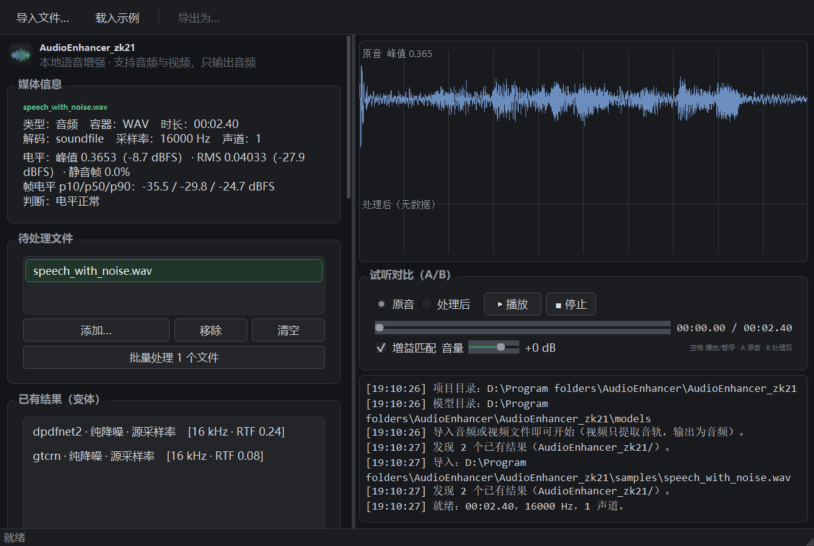
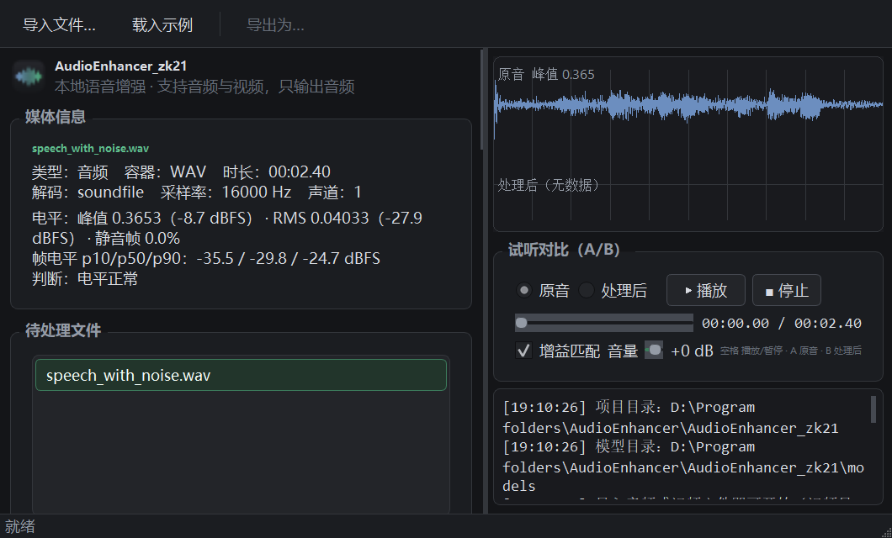
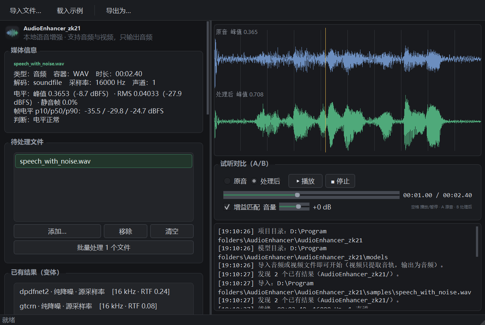

# AudioEnhancer_zk21

**English** | [中文](README.zh-CN.md)

A speech-enhancement desktop application that runs locally on your own machine. Import audio or video, pick a neural denoising model, process, audition before and after, export audio.

**It works without a network connection** (once the models are downloaded); **it needs no system ffmpeg**; **it needs no torch**; **CPU-only by default** — GPU is optional, and measured, it only pays off for bandwidth extension (running denoising on the GPU is **6.6× slower**, see [GPU / CUDA](#gpu--cuda-optional-conclusions-measured-first)).

---

## Contents

- [Quick start](#quick-start)
- [Desktop shortcut](#desktop-shortcut)
- [The interface](#the-interface)
- [Supported input formats](#supported-input-formats)
- [Model list and selection advice](#model-list-and-selection-advice)
- [Performance and resource measurements (measure before you change)](#performance-and-resource-measurements-measure-before-you-change)
- [GPU / CUDA (optional; measured conclusions first)](#gpu--cuda-optional-conclusions-measured-first)
- [Parameter reference](#parameter-reference)
- [Processing flow](#processing-flow)
- [Processing-chain defect history and fingerprint versions](#processing-chain-defect-history-and-fingerprint-versions)
- [Batch processing and variants](#batch-processing-and-variants)
- [Bandwidth extension and perceptual enhancement](#bandwidth-extension-and-perceptual-enhancement)
- [Real-material diagnosis: conclusions and the calibration they drove](#real-material-diagnosis-conclusions-and-the-calibration-they-drove)
- [Why there is no "fix unclear articulation" model](#why-there-is-no-fix-unclear-articulation-model)
- [Known limitations (read this section first)](#known-limitations-read-this-section-first)
- [Self-checks and tests](#self-checks-and-tests)
- [Directory layout](#directory-layout)
- [Network and mirrors](#network-and-mirrors)
- [Rolling back](#rolling-back)
- [License](#license)
- [Advice for speech-recognition (ASR) use](#advice-for-speech-recognition-asr-use)

---

## Quick start

```powershell
cd "<the directory the repository lives in>"

# create an isolated environment + install dependencies + self-check + download the default models (about 10 MB)
powershell -ExecutionPolicy Bypass -File setup_env.ps1

# start
.\.venv\Scripts\python.exe run.py
```

To download every model in one go (including the 25.7 MB DeepFilterNet3, about 80 MB in total):

```powershell
powershell -ExecutionPolicy Bypass -File setup_env.ps1 -All
```

**Requirements and manual installation.** You need **Python 3.12**: every pinned version in `requirements.txt` is confirmed to have a cp312 / win_amd64 wheel. `setup_env.ps1` looks for an interpreter of 3.10+ in the order `py -3.12` → `py -3` → `python`, and you can also point it at one explicitly with `-Python "C:\path\to\python.exe"`. `setup_env.ps1` does exactly five things: find an interpreter → create `.venv` inside this project directory (skipped if it already exists; delete it manually to rebuild) → upgrade pip and install `requirements.txt` → run the `tests\check_setup.py` self-check → download the default models. It **does not install, upgrade or uninstall anything in the Anaconda base**. The remaining switches are `-All` (download all models), `-SkipModels` (environment only, no model download) and `-SkipChecks` (skip the self-check).

If you would rather not use the script, three manual steps are enough (replace `<absolute path to your Python 3.12 interpreter>` with your own, e.g. `C:\Users\<you>\Anaconda3\python.exe`):

- Create the isolated environment: `<absolute path to your Python 3.12 interpreter> -m venv .venv`
- Install the dependencies: `.\.venv\Scripts\python.exe -m pip install --upgrade pip`, then `.\.venv\Scripts\python.exe -m pip install -r requirements.txt`
- Add the pre-release dependency: `.\.venv\Scripts\python.exe -m pip install --pre audiosronnx` (stable 0.0.1 only contains lavasr + novasr, so the other bandwidth-extension engines live in the pre-release and `--pre` is required; it pulls in onnxruntime and scipy, and is only needed if you use bandwidth extension)

Models can also be downloaded on their own: `.\.venv\Scripts\python.exe tests\download_models.py` (the default set = GTCRN + DPDFNet2 + sample audio, about 10 MB), `--all` (everything, about 80 MB, including the 25.7 MB DeepFilterNet3), `--engine dpdfnet8` (one specific engine), `--check` (probe source reachability only, no download). The URLs and their size/sha256 values are recorded in `models.json`, ordered **mirror-first**, with per-source fallback and resumable downloads; you can also select a model in the interface and click "Download selected model". **The app still starts with models missing** — the affected engines simply show "needs download", and you can retry from the interface at any time.

Starting it: `.\.venv\Scripts\python.exe run.py` (with a console, so you can see the output); the desktop shortcut uses `.\.venv\Scripts\pythonw.exe run.py` (no console window). At startup `run.py` imports PyQt5 / numpy / soundfile / soxr / av / sherpa-onnx / sounddevice one by one, and if any of them is missing it prints the list and writes it to `out\startup_error.log` instead of exiting silently.

For large wheels — especially the optional CUDA runtime — **always add the Tsinghua TUNA mirror**: `-i https://pypi.tuna.tsinghua.edu.cn/simple`. Measured on this machine the default index gives only 256 KB/s while TUNA gives 10.8 MB/s; see "[Network and mirrors](#network-and-mirrors)".

---

## Desktop shortcut

**It has already been created**, right on your desktop, named `AudioEnhancer_zk21`. Double-click to start; no console window appears.

If you need to rebuild it (new machine, moved project directory, accidentally deleted it):

```powershell
cd "<the directory the repository lives in>"
powershell -ExecutionPolicy Bypass -File make_shortcut.ps1

# also put it in the Start menu
powershell -ExecutionPolicy Bypass -File make_shortcut.ps1 -StartMenu
```

What the shortcut is made of:

| Item | Value |
| --- | --- |
| Target | `.venv\Scripts\pythonw.exe` (**pythonw**, not python, hence no console window) |
| Arguments | `run.py` (an absolute path inside the project) |
| Working directory | the project root |
| Icon | `icon.ico` (inside this project; all 7 sizes from 16 to 256 were redrawn separately) |

**A failed start does not vanish silently**: `run.py` first writes `out\startup_error.log` and then pops up a system message box showing the reason (it calls `MessageBoxW` directly via ctypes, so it still shows even if Qt itself fails to import). This only happens when started without a console; when you start it from the command line with `python.exe`, the error is printed to the terminal and no dialog interrupts you.

To regenerate the icon (you changed the palette or want a different style), edit the `ENVELOPE` and colour constants in `make_icon.py`, then

```powershell
.\.venv\Scripts\python.exe make_icon.py
```

---

## The interface

Left-hand side (top to bottom):

| Area | Contents |
| --- | --- |
| **Media info** | File type (audio / video), container, duration, decoder, sample rate, channels; for video it also shows the picture format and **explicitly states that the picture is not processed**. Containers with several audio tracks get a "Track" dropdown. |
| **Level statistics** | Peak / RMS (dBFS), share of silent frames, frame-level p10/p50/p90, plus a one-line verdict (e.g. "level is low, consider enabling gain normalisation"). |
| **Files to process** | A multi-select list. `Add…` accepts several files at once, and you can also drag several files into the window together. **Whichever row you select becomes the "current file"**; `Batch-process N files` runs batch processing over the checked files. |
| **Existing results (variants)** | **Every result that already exists** in the output directory of the current file. Selecting one gives you an A/B audition against the original. The list comes from disk, so it **survives switching files and even restarting the app**. |
| **Model** | A list of 11 engines, labelled `ready / needs download / no download needed`, with speed and size; below it, a description of the selected model. |
| **Preset** | Three presets — "For recognition (faithful)", "De-muffle (faithful)" and "For audition (enhanced)" — plus a bandwidth-extension engine dropdown. A preset only sets the parameters below for you and **does not bypass** them — so you can still fine-tune each one afterwards. |
| **Parameters** | Denoise strength, trim leading/trailing silence, gain normalisation, keep stereo, thread count, output format, output video, write automatically, high-pass, perceptual enhancement (shelf EQ / compression), de-muffle. |
| **Run** | Start processing / cancel, progress bar, status text. |

Right-hand side: the waveform comparison view (top = original, bottom = processed, with the silence regions that will be trimmed shown dimmed), A/B audition, and the log.

Audition shortcuts: **Space** play/pause · **A** hear the original · **B** hear the processed result. Clicking on the waveform seeks.

**Clicking a variant under "Existing results" auditions it directly**: switching variants resets the playback position to zero (a variant is reloaded into the player as a whole, a deliberate trade-off — see "Known limitations").

**"Gain matching" is on by default**: RMS necessarily drops after denoising, and without compensation "quieter" gets misheard as "worse". That compensation **applies to audition only and is never written into the output file**.

The interface uses a **dark theme** (`ui/theme.py`: Fusion style + dark QPalette + global QSS); its colours come from the same source as the app icon — the primary green `#4fa97a` means "processed", the secondary blue `#6c8ebf` means "original".

There is one deliberate decision in the layout: **the whole left-hand column sits inside a scroll area**. When the window gets shorter a scrollbar appears instead of the child widgets being squashed — the root cause of the earlier "model description text covers the model list" bug was Qt forcibly compressing child widgets when vertical space ran out. The model description is a **fixed-height** read-only box (its contents scroll on their own and can be selected and copied), not a `QLabel` that grows by wrapping.

The three groups added later — "Files to process", "Existing results (variants)" and "Preset" — also hang off that column and are absorbed by the same scroll area. `tests/render_ui.py` checks, at 4 window sizes (the smallest being 1000×560), whether sibling widgets overlap, whether the left column's content is clipped horizontally, and whether the model list is squeezed below its lower bound — so when you add widgets to the left column you do not have to eyeball it; just run it.

There is one more "prevent mis-clicks" design decision: **the wheel behaviour of dropdowns / spin boxes / sliders has been changed** (`ui/wheel_guard.py`). By default Qt changes a selector widget's value whenever the mouse merely rests on it, and since the whole left column is inside a scroll area, "scroll the page down" often turned into "changed a parameter", with no feedback afterwards. The rules are now:

| Situation | Behaviour |
| --- | --- |
| The widget **does not have focus** (the common case) | The wheel goes to the enclosing scroll area — the page scrolls as usual, the widget's value **does not change** |
| The widget **has focus** (you just clicked it; the intent is explicit) | Qt's native behaviour is kept, so you can nudge the value with the wheel |
| No enclosing scroll area can be found | The wheel event is swallowed without changing the value (better to lose that one scroll than to change a parameter by accident) |

Two pitfalls we stepped into, recorded here: **do not `sendEvent` the same wheel event object to the scroll area's viewport again** — measured, that makes the process crash outright inside event dispatch (it reliably crashes on an empty dropdown and on a non-empty one as well; taking the guard out makes everything normal, verified A/B), so it was changed to drive the scrollbar directly. Also, that assertion section in `tests/smoke_ui.py` **deliberately** changes widget values (as a reverse verification) and must restore the originals when it is done — a measured pitfall: it changed "bandwidth extension" from off to on, which made the "length alignment" assertion later in the same suite fail.

### Interface screenshots

Running `tests/render_ui.py` renders with the real windows platform (without popping up a window) and saves three screenshots into `out/`:

| File | Contents |
| --- | --- |
| `ui_01_ready.png` | media just imported, not processed yet |
| `ui_02_small.png` | the left column scrolling at the minimum size (1000×560) |
| `ui_03_processed.png` | processing finished: dual waveforms, A/B, log |

Those three images ship with the repository under `docs/screenshots/`, referenced directly below:

**Media just imported, not processed yet**



**The left column scrolling at the minimum size of 1000×560**



**Processing finished: dual waveforms, A/B, log**



---

## Supported input formats

What counts is the **stream type inside the container**, not just the extension.

**Audio**: `wav` `flac` `mp3` `ogg` `oga` `opus` `m4a` `aac` `wma` `aiff` `aif` `caf` `au` `w64`

**Video (audio track only, audio output)**: `mp4` `mkv` `mov` `avi` `webm` `flv` `ts` `m4v` `wmv` `mpg` `mpeg` `m2ts` `vob` `3gp` `rmvb` `asf`

- `wav/flac/ogg/opus/mp3` go through soundfile (which bundles libsndfile).
- `m4a/aac/wma` and all video containers go through PyAV (which bundles FFmpeg, so **no system ffmpeg is needed**).
- Containers with several audio tracks (common in mkv/ts) let you pick a track in the interface; the default is the first one.
- A video with no audio track produces an explicit error rather than failing silently.
- Output is always audio: `WAV 24-bit` (default) / `FLAC 24-bit` / `MP3`.

---

## Model list and selection advice

RTF = processing time / audio duration; **smaller is faster**. The table below was measured on this machine (i7-13700H, 2 threads, CPU only).

| Model | Size | Measured RTF | Advice |
| --- | --- | --- | --- |
| **DSP baseline** | built in | **0.008** | For reference. A conventional high-pass plus spectral gating, it makes no "inference" at all, so there is no musical noise — but it cannot remove non-stationary noise either. |
| **GTCRN** | 523 KB | 0.07–0.08 | The fastest. Clearly weaker than DPDFNet under strong noise. Good for a quick preview. |
| **DPDFNet baseline** | 8.3 MB | 0.06–0.08 | Better than GTCRN; the "good enough" floor. |
| **DPDFNet2** (default) | 9.7 MB | 0.13–0.15 | **The best speed/quality balance; the everyday first choice.** |
| **DPDFNet4** | 11.1 MB | 0.22–0.32 | Higher quality, roughly 2× the time. |
| **DPDFNet8** | 13.9 MB | 0.37–0.56 | Highest quality, roughly 3–4× the time. Use with care on long audio. |
| **DPDFNet2 48kHz HR** | 10.0 MB | 0.20–0.24 | A native 48 kHz model, suited to 48 kHz material. **Note: 16 kHz input is upsampled to a 48 kHz output.** |
| **DeepFilterNet3** | 25.7 MB | 0.19–0.22 | The classic DFN3, as the official Rust executable. A different model family, good for comparing against DPDFNet. |

Of the 8 denoising engines above, **the DSP baseline is a built-in implementation** (no weights), 6 DPDFNet/GTCRN models come from the single `sherpa-onnx` dependency, and **DeepFilterNet3 is a separate exe with the weights embedded and no mirror** (GitHub is its only source).

### Bandwidth extension (generative, off by default)

These 3 engines are **different in kind** from the table above, so they are listed separately: denoising *removes* content, bandwidth extension **generates** it.

**Their memory cost differs wildly, so the block length is fixed per engine.** Measured (2026-09-22, 48 kHz mono real material, peak resident tracked in a separate process):

| Engine | 2 s block | 5 s block | 20 s block | Block length used |
| --- | --- | --- | --- | --- |
| NovaSR | 213 MB | 379 MB | 1242 MB | 20 s (default) |
| LavaSR | 168 MB | 191 MB | 327 MB | 20 s (default) |
| **HiFi-GAN BWE** | 2042 MB | — | **7509 MB** | **2 s** |
| (10 s block of HiFi-GAN: 4340 MB) | | | | |

**HiFi-GAN BWE is the odd one out**: the default 20 s block needs 7.5 GB of memory and is bound to fail on a machine with 4 GB free (measured twice as a single failed allocation: 498 MB and 1.48 GB), while the batch memory guard only assumes "200–500 MB per instance" and cannot see this spike at all. So it alone uses a 2 s block — and the cost was measured to be negligible (a 2 s block versus a 20 s block differs by only **0.07% relative RMS** in the output, with an identical per-band spectrum), while the peak drops to about 2.0 GB (measured: both 30 s and 60 s inputs run to completion, and **the peak is independent of material length**, because the peak is set by a single block).

In addition, a memory pre-check was added **before** loading the model (`estimate_peak_mb()` in `core/bwe.py`): it estimates the requirement from the `cost = slope × block length + fixed overhead` fitted to the table above, and if free memory is insufficient it **refuses explicitly** and tells you what to do (close other programs, or switch to NovaSR, which needs about 1/6 of the memory for the same duration), instead of leaving the failure to some random allocation deep inside ORT. When memory information cannot be obtained it treats it as "unknown" and lets it through, so that a machine where probing fails does not lose the feature entirely.

| Engine | Size | Measured RTF | Above 8 kHz, relative to the passband (engine's **raw** output) | Notes |
| --- | --- | --- | --- | --- |
| **NovaSR** (the default) | 228 KB | **0.15** | +13.7 (8–12k) / +24.2 (12–20k) dB | A time-domain convolutional generator of about 52K parameters, 16 kHz → 48 kHz. It sounds the least harsh, so it is the default. |
| **HiFi-GAN BWE** | 4.2 MB | ~0.8 | +26.2 / +29.4 dB | HiFi-GAN wavenet bandwidth extension, MIT licensed, the lightest high-frequency restoration option. |
| **LavaSR** | 60 MB | **0.13** | +71.1 / +89.1 dB | Vocos bandwidth extension + Linkwitz–Riley spectral merging. It advertises "keep the lows, replace only the highs", but measured, all three engines keep the lows (correlation with "denoise only" below 5 kHz is 0.999–1.000), so this is not unique to it. **Note: this document earlier recorded its RTF as 1.94 ("slower than real time") — that did not reproduce this round** (measured 0.129, almost exactly as fast as NovaSR's 0.124; the user's own run log also contradicts 1.94). |

The last column above is the level imbalance of the **engine's raw output** (defect ④). The pipeline does not deliver it as is: `core/bwe.py` aligns passband loudness back to the input and pushes the generated band to **12 dB below the passband** (`PipelineOptions.bwe_hf_target_db`).

But that "absolute level target" has a trap in the opposite direction (defect ⑤, fixed 2026-09-21): **when the model's raw high frequencies are already far below the target, the rule turns into enormous amplification instead**. Measured, NovaSR's raw high frequencies on real material sit about 42–55 dB below the passband, the balance therefore computes **g_hf = +31.56 dB**, and lifts the model's broadband noise floor into an audible layer of high-frequency hum. There is now a guard: **the gain of the generated band may only be pushed down, never up** (`bwe.MAX_HF_BOOST_DB`, default 0 dB). See "defect ⑤" below for details.

All three engines output **48 kHz** (when bandwidth extension is active the pipeline outputs its native sample rate by default instead of converting back down to the source rate).
The weights come from hf-mirror (`huggingface.co` is unreachable on this machine), and the inference wrapper is provided by `audiosronnx` (a pre-release, see `requirements.txt`).

The default option in the interface comes from the `bwe_default` flag in `models.json` (set on NovaSR). Previously `EngineSpec` had no such field, the loader would **silently drop** it, and the default effectively degraded to "take the first entry in the manifest order" — that has been fixed along with it, so the flag is now preserved.

---

## Performance and resource measurements (measure before you change)

Every number in this section is **measured** (2026-09-21; this machine: 20 threads / 15.6 GB RAM / RTX 4060 Laptop 8 GB),
and the material is a real screen recording, `bandicam 2026-09-21 13-54-07-025.mp4` (48 kHz stereo, 1077 s).
To reproduce: `tools/measure_stages.py` (it re-runs the interface presets and prints the seconds for every stage).

### Stage timings: the bottleneck is inference, not decoding or resampling

The whole "For audition (enhanced)" chain (DPDFNet2 + NovaSR bandwidth extension + shelf + compression + normalisation, 2 threads):

| Stage | Seconds | Share |
| --- | --- | --- |
| Denoise inference | 261.9 | 62.4% |
| Bandwidth extension | 123.3 | 29.4% |
| Perceptual EQ | 10.4 | 2.5% |
| Pre-processing (high-pass + input normalisation) | 9.8 | 2.3% |
| Silence trimming | 3.7 | 0.9% |
| Reverb metrics | 2.6 | 0.6% |
| Compression | 2.1 | 0.5% |
| Output normalisation | 2.0 | 0.5% |
| Decoding | 1.8 | 0.4% |
| Level statistics | 1.7 | 0.4% |
| Writing | 0.7 | 0.2% |
| Resampling / duration alignment | 0.0 | 0.0% |
| **Total wall clock** | **420.0** | RTF 0.389 |

Four conclusions:

1. **Inference accounts for 91.8%** (denoising 62.4% + bandwidth extension 29.4%). The guesses that "the bottleneck might be decoding / HQ resampling / concurrency being squeezed to 1 by memory" are **disproved**: decoding 1.8 s, resampling **0.00 s** (the bandwidth extension output rate happens to be exactly 48000, so no resampling is needed), duration alignment 0.00 s.
2. **Writing 310 MB took only 0.67 s**, so excluding writing from `elapsed`/`RTF` made no measurable difference (the accounting is still kept separate so it can be compared with historical numbers).
3. **A single 18-minute stereo file through the whole chain peaks at 7358 MB resident.** That is the real reason batch processing must converge on memory rather than on core count — an order of magnitude above "200–500 MB per instance". Factor this in when batch-processing long files.
4. The measured RTF of the three bandwidth-extension engines **does not match** what this document recorded earlier: on the same 120 s excerpt, NovaSR took 14.9 s and LavaSR 15.5 s (RTF 0.124 / 0.129), **almost equally fast**. The earlier "LavaSR RTF 1.94, slower than real time" **did not reproduce** — the user's own run log from 2026-09-21 21:04 also contradicts it: that whole chain including LavaSR took 502 s in total, and if LavaSR really had RTF 1.94 that run would have needed at least 2000 s.

### Thread count: not "peaking at 2–4", but ≥4 being slower

Same material, an excerpt, denoise inference only, run one after another inside the same process. To rule out "it gets hotter as it goes", the **same configuration is run once at the beginning and once at the end**:

| Engine (excerpt) | 1 thread | 2 threads | 4 threads | 8 threads |
| --- | --- | --- | --- | --- |
| DPDFNet2 (180 s) | 47.0 s | 46.9 / 47.7 s (first and last) | 56.5 s (**+20%**) | 59.1 s (**+25%**) |
| GTCRN (120 s) | 10.5 s | 10.9 s | 13.5 s (**+25%**) | — |
| DPDFNet8 (120 s) | 76.9 s | 74.4 s | 82.3 s (**+11%**) | — |

(Another round on a 300 s excerpt with DPDFNet2: 70.3 s on 2 threads → 89.4 s on 4 threads (+27%) → 98.4 s on 8 threads (+40%), the same direction.)

- The two "2 threads" runs at the beginning and the end differ by only **1.8%**, so ordering / heat is not the cause; this is a genuine thread effect.
- **1 and 2 threads are equivalent within noise; from 4 threads on it gets consistently slower** (+11%–25% relative to the default of 2), and 8 threads is slower still.
- So the thread count **stays at the default of 2, and should not be raised**. What this document and the interface used to say — "this machine has 20 threads, the benefit peaks around 2–4" — was an **unmeasured statement, and it was wrong**; it has been corrected.
- A measurement caveat: on a quiet machine, repeated measurements of the same configuration have about ±2% noise; with other load (a browser playing video, a game, remote control) it grows past 20%. So **only large effects are trusted here** — a difference below about 7% is not enough to conclude anything.

### How the RTF table should be read

The RTFs in "Model list" above are **mono** measurements (16 kHz, short clips), i.e. the time **per channel**. Stereo material costs 2×: measured, DPDFNet2 on 48 kHz stereo gives RTF 0.23–0.27 (= 0.12–0.13 per channel, consistent with the 0.13–0.15 in the table).

### Long material: the real bottleneck is peak memory in the "frame level" layer (measured and fixed 2026-10-01)

The run the user reported as "too slow" was **4139 s (69 minutes) of 48 kHz stereo** with `deepfilternet3` and the "De-muffle (faithful)" preset, measured at `elapsed 734.72 s` / `RTF 0.1775`. The two groups below were both obtained by running the same machine, the same day, on the same material, once before and once after the change (`tools/measure_stages.py`, 2 threads).

**A. Controlled experiment (fixed 1200 s excerpt starting at 900 s, lossless FLOAT wav) — the cleanest accounting of the lot**

| Stage | Before | After (automatic channel parallelism) | Factor |
| --- | --- | --- | --- |
| Denoise inference (DFN3 ×2 channels) | 219.23 s (83.0%) | **139.62 s** | **1.57×** |
| Silence trimming | 5.87 s | **3.90 s** | 1.51× |
| Pre-processing (high-pass) | 14.62 s | 15.42 s | within noise |
| Perceptual EQ | 14.54 s | 14.90 s | within noise |
| Level statistics / output normalisation / reverb | 2.61 / 3.32 / 3.79 s | 2.64 / 3.22 / 4.16 s | within noise |
| **Total wall clock** | **264.21 s** (RTF 0.220) | **184.04 s** (RTF 0.153) | **1.44×** |
| **Peak process resident** | **4873 MB** | **2480 MB** | **−49%** |

**B. The user's real material, whole file (4139 s, `--no-write`, each run once within the same session)**

| Stage | Frozen baseline (pre-change code) | After | Factor |
| --- | --- | --- | --- |
| Decoding | 15.08 s | 14.61 s | 1.03× |
| Silence trimming | 30.55 s | **17.33 s** | **1.76×** |
| Pre-processing | 51.17 s | 56.24 s | within noise (slightly slower) |
| Denoise inference | 698.94 s (78.4%) | **473.82 s** | **1.475×** |
| Perceptual EQ | 52.94 s | 47.86 s | 1.11× |
| Level statistics / output normalisation | 9.34 / 10.50 s | 9.39 / 10.55 s | 1.0× |
| Reverb metrics | 22.84 s | **15.40 s** | 1.48× |
| **Total wall clock (excluding writing)** | **891.44 s** (RTF 0.215) | **645.23 s** (RTF 0.156) | **1.38×** |
| **Peak process resident** | **10149 MB** (free memory briefly hit **0.00 GB** = paging) | **6949 MB** | **−32%** |

In the same session the baseline was 891.44 s while the user's own record of 734.72 s is faster — a 1.21× gap, which means the machine was under less load during the user's run (an existing accounting rule of this project: with load, measurement noise exceeds 20%). **So quote the speed-up from the A/B pairs above, not from "734.72 → 645.23".**

Four conclusions:

1. **Denoise inference accounts for 78–83%**, and `deep-filter.exe` **uses only about 1 core** (pid-level sampling over 6 s gives a CPU increment of 0.98 cores on a 20-logical-core machine; during the whole run **2** `deep-filter.exe` processes were measured at once, each at about 0.98 cores) → channel parallelism is the most direct speed-up: each channel is already an **independent** invocation (the way to preserve the stereo image is precisely "apply the same model to the left and right channels separately"), parallelism is only scheduling, and **the result is bit-identical to serial** (`tests/check_speed.py` asserts `np.array_equal`). The measured 1.475–1.57× rather than 2× comes from the two child processes sharing the disk (each reading/writing a temporary WAV of the whole file) plus the numpy/soundfile calls on the main thread.
2. **The dominant cause of peak memory is not inference but the whole frame matrix in the "frame level" layer.** The old implementation (`_frames()`) materialised the `(n_frames, win)` index matrix and the sample matrix in one go, with a cost growing linearly in duration: 1200 s mono cost **2197 MB** for a **single** traversal (tracemalloc), and that path runs 5–7 times in the whole chain. The measured peak resident for the whole chain was 300 s→1249 MB, 1200 s→4873 MB, 4139 s→10149 MB (baseline slope **≈ 4.03 MB × material seconds**). After switching to index-based chunking (`dsp.frame_rms_streaming`) the same traversal drops to **76 MB** (29×) and the whole-chain slope drops to **≈ 1.63 MB × seconds** (4139 s: 6949 MB); the "0.00 GB free memory" paging seen during the baseline run no longer occurs.
3. **The pure-Python loops outside denoise inference are not as expensive as they look.** There was a plan to vectorise the per-frame overlap-add in `_istft_block` (reshape + whole-block addition) — **measured, it was 15% slower** (median 62.5 ms versus 53.8 ms on a 30 s block), because a whole-block addition re-reads and re-writes the entire output array every time whereas the per-frame path only touches an 8 KB contiguous slice; only when the OLA is timed in isolation does the new approach look "slightly faster" (17.7 versus 20.1 ms). The real cost in that same block is `irfft` (24 ms). **That optimisation was disproved by measurement**, so the code keeps the original implementation and this measurement was written into the docstring of `dsp._istft_block` (so it is not tried again next time). Pre-processing and perceptual EQ therefore show **no substantial improvement** (all measured differences are within noise).
4. **When writing back to video there is a hidden "write" cost that is not in `elapsed`/`rtf`.** Measured (a 300 s stereo 48 kHz source written back to mp4): `write 9.88 s`, i.e. AAC encoding at about **30× real time**, extrapolating to about **136 s** for 4139 s — nearly a fifth of that user's total wall clock, and **entirely absent** from `elapsed 734.72 s`. This was not optimised (FFmpeg's native AAC encoder is essentially single-threaded; the picture is stream-copied and accounts for only 1–2 s); what this round did was **make it visible**: `stats.stage_times.write` is now written into the manifest. When only audio is output, writing is negligible (a 310 MB wav measured 0.67 s).

### One optional further speed-up (measured, not done this round)

`scipy.fft.rfft/irfft(workers=-1)` on the same 30 s block is **13.4 ms versus numpy's 28.0 ms (2.1×)**, and the FFT is the bulk of the pre-processing / perceptual EQ stages (about 11% of wall clock together). It was not done because scipy is only an **optional** dependency pulled in by `audiosronnx` (line 24 of requirements.txt); as soon as a user does not install bandwidth extension it goes missing, creating a brand-new "faster with scipy, slower without" branch out of thin air. To really do it, scipy would first have to be promoted to an explicit dependency.

### Second round: converting every "whole-file-level" temporary array to chunked (measured 2026-10-01)

After the first round split the whole frame matrix in the "frame level" layer into chunks, the remaining peak was held up by another style of code:
`np.sqrt(np.mean(np.square(x.astype(np.float64))))` — it promotes the whole file to float64 (4→8 bytes)
and then makes another copy of the squared result, so **its instantaneous memory is 4× the material's byte count**. An audit found the same pattern scattered in 4 places:

| Location | Before (measured peak, 1200 s stereo/mono) | Notes |
| --- | --- | --- |
| `dsp.analyze` | **1099 MB** | called 2–3 times per run |
| `dsp.normalize` (peak mode) | **879 MB** | called 2 times per run |
| `engines._pad_tail` | **879 MB** | **once per channel**, and only to compute a gain for a ~30 ms tail |
| `ui/player._recompute_match_gains` | **1758 MB** | on every load / every toggle of "gain matching", **and executed while holding a lock in a Qt slot** (UI freeze) |

They now all go through `dsp.rms_blockwise / peak_blockwise / clipped_ratio_blockwise` (chunked accumulation, peak O(chunk) instead of O(material)). Measured on the same array: **634 ms / 1758 MB before → 645 ms / 122 MB chunked, with a relative numerical difference of 0** (`tests/check_speed.py` asserts this item by item). There are three more changes of the same kind:

- PyAV decoding in `media_io` now uses a **pre-allocated output buffer** (the old "collect all chunks then concatenate" measured a peak of **2.01×** the result's byte count: 884.8 MB for 1200 s stereo versus a 439 MB result) → measured **1.10×**;
- `ui/waveform` no longer keeps a whole-file mono copy per track (69 minutes of 48 kHz stereo = 763 MB per track, and it was done synchronously on the UI thread at import time) → it computes the envelope column-chunked instead, with the **envelope bit-identical**;
- the "no-op" branch of `enhance.spectral_shape` no longer does `x.copy()` (a pointless 1.59 GB copy for 69 minutes).

### Third round: extending parallelism to the FFT stages + reusing the decoded result from import (2026-10-01)

1. **Perceptual EQ / pre-processing are now channel-parallel too** (`spectral_shape(workers=…)`): measured on 1200 s stereo,
   **15.09 s → 9.92 s (1.52×)**, and on 300 s 3.05 s → 2.67 s (1.14×), **bit-identical**.
   It works because this stage is FFT-dominated and numpy's pocketfft releases the GIL in C.
   (The plan item "vectorise the OLA in `_istft_block`" **was disproved by measurement**: see above, 15% slower; the original implementation stays.)
2. **Audio that was already decoded at import time is handed straight to the pipeline** (`PipelineOptions.predecoded`): decoding a 69-minute video
   measured 14.61 s / 1.59 GB, and previously analysis decoded it once and processing decoded it again, **keeping two copies of the same material at once**.
   Now it is validated by (absolute path, track number) and reused with zero copies, and the pipeline also compares the duration once more (within 2% or 1 s),
   falling back to decoding normally if they do not match. Measured: on a hit, `media_io.decode` is called **0 times** and the result is bit-identical;
   when the duration does not match it **falls back to decoding** (`tests/check_speed.py` asserts this).

### Channel parallelism (`PipelineOptions.parallel_channels`)

- `auto` (default): decided by a **free-memory** gate; if there is enough, 2 channels run at once. The memory needed is computed from the material length: `fixed overhead + 12 B per sample (DFN) / 6 B (sherpa) / 3 B (dsp) × mono sample count + 600 MB margin`. For 4139 s stereo the measured gate value is **3474 MB**.
- `off`: force serial. `on`: force parallel and **skip the gate** (it prints a notice; the user takes the risk).
- When memory is insufficient it **unambiguously falls back to serial and logs the reason** (no silent downgrade, no charging into an OOM): free memory on this machine is between 3–7 GB all year round, and 69-minute material really may not fit.
- This parameter **does not enter the fingerprint**: it only changes scheduling, not values (same as `num_threads`).
- Boundaries **not verified** on user material: >2-channel material (`auto` allows at most 2 concurrent), and bandwidth extension together with channel parallelism on an 8 GB VRAM card (bandwidth extension stays **serial per channel**, because it already runs under `HEAVY_STAGE`).

### Stage timings are now written into the manifest

`stats.stage_times` (keys identical to `core/pipeline._STAGE_LABELS`, including `write`), `stats.wall_s`, `stats.channels` and `stats.device_notes` are all recorded in `manifest.json`. Previously it was "record first, `mark('write')` later", so the cost of writing to disk / writing back to video **never made it into the manifest** — that 734.72 s run of the user's left only `elapsed`, and the bottleneck breakdown was lost forever (guessable only by extrapolation). The accounting of `elapsed`/`rtf` is **unchanged** (still excluding writing) so it stays comparable with historical numbers; to see the total wall clock use `wall_s` or the sum of the stages.

### Denoise strength (`attenuation_limit_db`) measured: semantics and impact

This parameter was written the wrong way round earlier in this document ("0 dB ≈ no denoising"), so it was measured properly on its own:

**Semantics — `0` means "no limit", not "no denoising".** With pure white noise as input (−30.5 dBFS), the parameter value and the measured attenuation:

| `attenuation_limit_db` | 0 | 3 | 6 | 12 | 18 | 30 | 60 |
| --- | --- | --- | --- | --- | --- | --- | --- |
| Measured attenuation | **69.3 dB** | 3.0 | 6.0 | 12.0 | 18.0 | 30.0 | 58.3 dB |

So `3–30` are the literal dB limits, while `0` shoots straight to 69 dB (harsher than `60`). **On real material this shows up as pushing the quietest frames down to −107.8 dBFS** (digital silence) — exactly the "hard gate that squashes pauses into digital silence" this project explicitly opposes elsewhere. The difference between `0` and `30` is **not "pressing less" but "pressing more"**, and it is easily mistaken for "denoising switched off". (`DeepFilterNet3` uses the opposite convention for the same parameter: `0` = no denoising, `100` = no limit.)

**Impact — between 6/12/18 a difference is barely measurable.** A comparison of four values on the same 60 s real excerpt:

| `att` | Output RMS | Frame level p50 | Noise-floor reduction in silent stretches |
| --- | --- | --- | --- |
| 0 | −33.75 dBFS | −51.3 | 21.1 dB |
| 6 | −33.47 | −50.8 | 21.1 dB |
| 12 | −33.65 | −51.2 | 21.1 dB |
| 18 | −33.71 | −51.2 | 21.1 dB |

The three values give an **identical** noise-floor reduction (21.1 dB) and RMS values within 0.3 dB — so on this conversational material the model barely touches the limit at all, and **this knob does not change the result anywhere in the 6–18 range**. That the three presets leave it alone (default 12) is therefore a choice **supported by measurement**, not laziness. The only value worth watching out for is `0`.

---

## GPU / CUDA (optional; measured conclusions first)

**In one sentence: the GPU helps bandwidth extension (1.5× faster); on sherpa denoising the GPU is 6.6× slower; DeepFilterNet3 has no usable GPU path.** The default configuration was written from these measurements, so **not enabling the GPU is already the current optimum**; installing a GPU only makes the bandwidth-extension option faster.

### Why DeepFilterNet3 has no GPU path (probe measurements, 2026-10-01)

That user's engine was `deepfilternet3`, which accounts for 83% of the whole chain, so "can it go on the GPU" had to be answered first:

- We use the official Rust executable `deep-filter-0.5.6-x86_64-pc-windows-msvc.exe` (weights embedded, 26.9 MB). The full option list from `deep-filter.exe --help` is: `-m/--pf/--pf-beta/-D/-a/--min-db-thresh/--max-db-erb-thresh/--max-db-df-thresh/--reduce-mask/-v/-o/-h/-V` — **there is no `--cuda`, and no `--threads`**.
- It is not only CPU-only, it is **essentially single-threaded**: pid-level sampling over 6 s gives a CPU-time increment of **0.98 cores** (on a 20-logical-core machine).
- Switching to a torch/CUDA build of DFN would add about 2.5 GB of dependencies (there is no torch in this machine's venv, and none was installed), and there is already a counter-example for this class of "small-kernel per-frame model" on this machine: CUDA on sherpa's DPDFNet is **6.6–15× slower** (see the table below and "Supplementary experiment for last round's unverified items").
- So **this round does not touch the GPU**: the 83% that is the user's bottleneck cannot gain from the GPU, and the only verified GPU gain (bandwidth extension ×1.48–1.62) is not in that preset and is already enabled by default in the code. At the time that card also had 5.0/8.0 GB of VRAM occupied by something else (`nvidia-smi`).

**Conclusion**: to speed up this kind of material the right levers are **parallelism + fewer whole-file traversals** (see "Long material" above), not the GPU.

### Measured (2026-09-21, RTX 4060 Laptop 8 GB, real material excerpts, each repeated 2–3 times)

| Stage | CPU | CUDA | Conclusion |
| --- | --- | --- | --- |
| Bandwidth extension NovaSR (20–28.8 s excerpt) | RTF 0.066–0.083 | RTF 0.041–0.053 | **1.48–1.62× faster** → `auto` picks CUDA |
| sherpa denoising DPDFNet2 (30 s excerpt) | 3.79 / 3.90 s (RTF 0.126) | 25.18 / 25.26 / 25.41 s (RTF 0.842) | **6.6× slower** → `auto` picks CPU |
| sherpa denoising DPDFNet2 (60 s excerpt) | 12.08 s (RTF 0.201) | 75.50 s (RTF 1.258) | same as above (the ratio is independent of length) |

Why denoising is slower on the GPU: DPDFNet is a **per-frame stateful streaming model**, so every frame dispatches a large number of tiny kernels and the GPU's kernel-launch and synchronisation latency outweighs the compute gain. The variance across three repeats is only ±0.5%, and the ratio is independent of audio length, so this is not "it was not warmed up" — being able to run on a GPU is not the same as being worth running on a GPU.

### The device is decided by `auto`, and `auto` is "only what has been measured"

`EngineParams` in `core/engines.py` has two device switches, both defaulting to `"auto"`:

- `bwe_device` (bandwidth extension): `auto` → use CUDA if there is CUDA and enough VRAM, otherwise CPU only.
- `sherpa_provider` (denoising): `auto` → **always CPU** (because it was measured to be 6.6× slower); overriding it requires passing `"cuda"` explicitly.

Neither **enters the fingerprint**: the device only affects speed and the output difference has been quantified — at most 1.06e-03 per sample for bandwidth extension (0.54% relative RMS) and 2.15e-04 (0.012%) for denoising. That is, they are **not bit-identical**, so reusing the same parameters **may** pick up a file computed by the other device; this is a deliberate trade-off (otherwise changing devices would force a full recompute), and the magnitude of the difference is as stated.

### Another measured hard constraint: two ONNX Runtimes in one process knock each other's CUDA out

pip's `onnxruntime-gpu` and sherpa-onnx **each ship their own copy of ORT**. Measured: once a process has created a CUDA session with pip's onnxruntime **first**, sherpa's bundled ORT inevitably fails when it initialises the CUDA provider (`Error 1114: DLL initialization routine failed`) and falls back to CPU.

- Impact: sherpa's `"cuda"` setting is **unreliable** in the real application (running bandwidth extension first triggers this). This is the second, independent reason not to put denoising on the GPU.
- The fallback is visible, not silent: `provider_desc()` reports "CPU (**fallback after the CUDA session failed to be created**: …)" and you can see it in the log.

**This conflict has one harder consequence: the process segfaults during shutdown.** Measured (reproduced 2/2):

| What the process did | Exit code |
| --- | --- |
| Only pip onnxruntime used CUDA | 0 |
| Only sherpa used CUDA | 0 |
| **pip used CUDA, then sherpa **requested** CUDA (which necessarily failed and fell back)** | **139 (segfault)** |
| **Default configuration**: pip uses CUDA + sherpa uses CPU | **0** |
| pip uses CUDA + sherpa explicitly CPU | 0 |

So **only the experimental path of "explicitly let sherpa try CUDA" crashes**, and it crashes during shutdown — by which time the result has long been written and the file is complete. The default configuration exits with 0 and the user never encounters it.

`tests/check_gpu.py` verifies the exit codes of these two paths in **separate child processes**, and records 139 as an **observed result** (not as a test failure, and not as "no problem"). The same suite contains `tests/gpu_probe.py` as a child-process probe: once isolated, sherpa's CUDA can genuinely take effect (with no pip ORT interference), so both its runtime and its CPU/GPU equivalence can be measured — measured CPU 3.82 s versus CUDA 35.26 s, with a maximum numerical difference of 2.18e-05 (0.010% relative RMS).

### How to install it (optional, about 2 GB; not installed by default)

Without it everything runs on the CPU and is fully functional. To try the GPU:

```powershell
# 1) CUDA 12.9 + cuDNN 9.26 runtime libraries are installed with the wheel (about 1.82 GB)
#    Do add a mirror: the default index was measured at only 256 KB/s, which takes over 2 hours
.\.venv\Scripts\python.exe -m pip install -i https://pypi.tuna.tsinghua.edu.cn/simple `
    "onnxruntime-gpu[cuda,cudnn]==1.26.0"

# 2) swap sherpa for the GPU wheel (about 191 MB, available only via hf-mirror; huggingface.co is unreachable)
#    Note: measured this round, it only makes denoising slower; do not install it unless you really want to run GPU comparisons
curl -L -o sherpa_gpu.whl "https://hf-mirror.com/csukuangfj2/sherpa-onnx-wheels/resolve/main/cuda/1.13.8/sherpa_onnx-1.13.8%2Bcuda12.cudnn9-cp312-cp312-win_amd64.whl"
.\.venv\Scripts\python.exe -m pip install --no-deps sherpa_gpu.whl
```

Why CUDA 12 rather than 13: `onnxruntime-gpu` has been built against CUDA 13 by default since 1.27, whereas sherpa's GPU wheel is `+cuda12.cudnn9`; using 1.26.0 (CUDA 12.8) lets the two **share a single set of CUDA 12 runtime libraries** instead of installing two 1.8 GB sets.

`core/cuda_env.py` is what lets ORT find the CUDA/cuDNN DLLs (they are neither on the venv's default search path nor in conda base's site-packages). The search order is `AE_CUDA_DLL_DIR` → the venv's `nvidia/*/bin` → conda base's `torch/lib` (base's torch 2.5.1+cu121 brings its own CUDA 12.1 + cuDNN 9.1). On a hit they are added to **this process's** PATH and to `os.add_dll_directory`; they are **used read-only — no DLLs are copied and the system PATH is not modified**. It also uses `nvidia-smi` for a VRAM pre-check (`AE_GPU_MIN_FREE_MB`, default 512 MiB); if there is not enough VRAM it falls back to the CPU instead of charging ahead.

"Which device was actually used" is **read back**, not declared: sherpa's Python API has no provider read-back (only `run`/`sample_rate`), so `cuda_env.loaded_cuda_providers()` **enumerates the modules already loaded into the process**, and only seeing `onnxruntime_providers_cuda.dll` counts.

### Rolling back (back to CPU only)

```powershell
.\.venv\Scripts\python.exe -m pip uninstall -y onnxruntime-gpu nvidia-cudnn-cu12 `
    nvidia-cublas-cu12 nvidia-cuda-runtime-cu12 nvidia-cuda-nvrtc-cu12 `
    nvidia-cufft-cu12 nvidia-curand-cu12 nvidia-nvjitlink-cu12
.\.venv\Scripts\python.exe -m pip install onnxruntime==1.30.0     # back to the original CPU build
.\.venv\Scripts\python.exe -m pip install sherpa-onnx==1.13.8     # back to the CPU-only wheel
```

After installing the GPU build, `pip check` reports that `audiosronnx`'s `onnxruntime` dependency is unsatisfied — that is **benign**: the `onnxruntime` module is still importable (provided by `onnxruntime-gpu`), only the distribution name differs.

### Supplementary experiment for last round's "unverified items" (2026-09-21 evening, now measured)

The previous version of this section listed two things that had not been done / measured. They have now been tested:

1. **Does the denoising GPU setting OOM on long material? — No, it is only slower.** Running DPDFNet2 in a separate process (avoiding the ORT conflict):

   | Material length | CPU | CUDA | CUDA VRAM increment |
   | --- | --- | --- | --- |
   | 60 s | 9.61 s | **144.45 s** (15× slower) | 72 MiB |
   | 180 s | 35.19 s | **253.53 s** (7.2× slower) | ≤ sampling precision |

   The VRAM increment stays on the order of 100 MiB (on an 8 GB card), nowhere near an OOM. So the checkpoint's worry that "`MAX_FRAMES_SINGLE_PASS` must be reduced or it will OOM" **did not reproduce**, and consequently that constant was **not changed for it** (the CPU path works fine, and it should not pay a chunking penalty for a slower path). Within the measured range (≤180 s, 8.6M frames) **no OOM was found**; longer material was not tested (at this speed one run takes over ten minutes), so **no upper bound was found** — recorded honestly.

2. **What does the GPU do under batch concurrency? — The application does not contend for VRAM internally, but do not run two instances at once.**
   - Inside the application's batch processing, the bandwidth-extension stage is already **serialised** by `HEAVY_STAGE` (`Semaphore(1)`), so two GPU tasks never contend for VRAM within one process.
   - Measured with **two independent processes** in parallel (equivalent to running two app instances) doing bandwidth extension: each took 6.00 / 6.15 s, while a single serial run took 4.14 s — **1.45–1.49× slower per file**, with a total wall clock of 8.96 s for two files versus 8.28 s serial, so **total throughput did not improve and in fact dropped slightly**. So do not run bandwidth extension in two instances in parallel.
   - During that parallel run the system-level VRAM increment reported about 4.5 GB, but **that number cannot be attributed**: under Windows/WDDM, `nvidia-smi --query-compute-apps` cannot get per-process VRAM, and Photoshop and DaVinci Resolve were using the card at the time too. So it **must not be used as a VRAM budget**; it is recorded here only as a methodological limitation.

   Still unverified: **BWE VRAM with multi-channel material** (every GPU number this round came from mono excerpts).

---

## Parameter reference

| Parameter | Description |
| --- | --- |
| **Denoise strength** (0–30, default 12) | Applies to DPDFNet only and maps to the model's `attenuation_limit_db` = **the maximum attenuation allowed**. **`0` is a special case: it means "no limit" (the harshest), not "no denoising"** — measured on pure white-noise input, `0` yields **69.3 dB** of attenuation, harsher than `60`; the other values are literal limits: measured, `3/6/12/18/30` yield 3.0 / 6.0 / 12.0 / 18.0 / 30.0 dB of attenuation. Another trap: **DeepFilterNet3 uses the opposite convention for the same parameter** (`-a`, 0 = no denoising, 100 = no limit), and the interface labels them separately. This document earlier wrote "0 dB ≈ no denoising", **which is backwards and has been corrected**. |
| **Trim leading/trailing silence** | Trims the silent stretch at the beginning/end against an adaptive threshold. The threshold is "high quantile of the frame level − 40 dB", clamped above −75 dBFS, so it adapts to material whose overall level is low instead of applying a fixed absolute value. **Silence in the middle is kept by default** (removing it would change the timeline). |
| **Gain normalisation** | When checked, the target level applies to the **output**. Internally it happens twice: levels are conditioned before the audio goes into the engine (which is more stable for low-level material), and re-corrected to the target after the engine, honouring the "output reaches the target level" contract. |
| **Keep stereo** | On by default. The enhancement models are all trained on mono, but applying the same model to the left and right channels separately is standard practice and preserves the stereo image. Turning it off downmixes to mono. |
| **Thread count** | The number of internal threads passed to the engine (default 2). **Measured: more is not faster** — 1 and 2 are equivalent, and from 4 threads on it is 7–29% slower (see "Performance and resource measurements" below). This parameter does not affect the result, only the speed, so it does not enter the fingerprint. |
| **Output format** | WAV 24-bit (default) / FLAC 24-bit / MP3. |
| **Write the result automatically when done** | On by default. The result is written according to the naming convention into the `AudioEnhancer_zk21/` subfolder **of the directory containing the input file** (no longer into the project's `out/`), carrying a parameter fingerprint for "reuse with the same parameters". When off, the result stays in memory only and you use "Export as…" in the toolbar when you need it on disk. |
| **High-pass (0 = off)** | A pre-processing stage shared by all engines, 80 Hz by default. It filters out DC and low-frequency rumble, and the DSP baseline has an equivalent step. |
| **Perceptual enhancement: high shelf** | A shelf boost lifts the "clarity" region at 2–5 kHz, with a fixed centre of 3000 Hz and an adjustable depth (0–12 dB, default 3). It **only changes the frequency response and invents no content** (unlike bandwidth extension). The centre is 3000 rather than 4000 Hz because of measurement: on real material 3000 Hz improved the muffle index by 7.21 dB while 4000 Hz only gave 5.54 dB. |
| **Perceptual enhancement: gentle compression (AGC)** | Narrows the dynamic range of speech, making quiet parts easier to hear. Measured: speech dynamic range 6.0 → 4.4 dB, maximum attenuation 5.78 dB, gain step 0.68 dB/frame (no pumping). |
| **De-muffle (200–500 Hz)** | A **bell-shaped** cut around 350 Hz (0 to −12 dB, default 0 = off) that removes the "muffled" build-up. A bell rather than a shelf is used so that the fundamental below 100 Hz is untouched — otherwise the voice becomes thin. The parameters were calibrated by measurement on real material; see "Real-material diagnosis" below. |
| **Output video** | **Decided per file, off by default, and never inherited from the previous file.** When checked, a video is output: **the picture and all other streams are copied as is, not re-encoded** (zero quality loss, close to the time of a disk copy), only the audio track is replaced by the enhanced audio, and the encoder is chosen from the source container (mp4→aac, mkv→aac, webm→libopus…). The input file is **never rewritten**. **Before** the run you can see in two places what will be output this time: the "This run outputs: …" hint line in the parameter area, and `output mode: … → <predicted filename>` in the log. In batch processing it is decided by **each file's own container**, listed one by one (the settings of "the file you are currently looking at" are not applied to the whole batch). |
| **Write the run log to disk** | The interface log is also appended to `<project>/out/run.log` (rotated once past 2 MB). The reason: started with pythonw there is no console, and `txt_log` is lost as soon as the window closes — which once lost the complete stage-by-stage breakdown of a 734.72 s run. |

---

## Processing flow

```
Import (audio file or video container)
  → probe: determine kind, enumerate tracks, read parameters
  → decode to float32 (video: audio track only)
     → [optional] trim leading/trailing silence
     → [optional] gain normalisation (input conditioning)
     → [optional] high-pass (default 80 Hz)
     → per-channel enhancement (the models take mono; **channels may run in parallel**, see "Channel parallelism")
     → [optional] bandwidth extension (generative, rewrites high frequencies)
     → [optional] perceptual enhancement: shelf EQ → gentle compression
     → resample to the target sample rate
     → align to the source length → [optional] output level normalisation
  → compute the parameter fingerprint → if a file with the same name exists, reuse it directly (no recompute)
  → write out per the naming convention → record the manifest (including stage timings, for later diagnosis)
```

Stage names are recorded in the log and in the result (of the form `highpass · normalize-pre · denoise · bwe:novasr · shelf · compress`), making it easy to confirm whether a given option really took effect. **Dereverberation is not among them** — the pipeline rejects it outright, see "Known limitations".

**Length alignment**: sherpa-onnx's offline interface outputs about one hop less than its input (frame-alignment truncation), and DeepFilterNet loses about 30 ms at the end because of its latency compensation. Both are padded from the tail of the source signal by an energy ratio, so that the A/B is strictly aligned.

The alignment criterion is **duration**, not sample count. This was once written wrong and the consequence was severe: when bandwidth extension takes 16 kHz up to 48 kHz the **sample count becomes 3× while the duration is unchanged**, so comparing sample counts truncates the 48 kHz extended result to **1/3 of its duration**, and that happened **silently** (the assertions downstream only looked at band content, never at duration). `align_to` now converts the target sample count from the duration and comes with three guards:

- A tail pad exceeding 1% (or 4800 frames) **raises an error** — that means the upstream stage has a substantive defect, and "pad the tail with the original" would hide it as "the second half is the original".
- An output that exceeds the source length beyond tolerance **raises an error** instead of being silently truncated.
- When merging per channel, a channel length difference above 4800 frames **raises an error** — inconsistent lengths between channels are always a defect, and silent truncation would write a file with "one channel fine, one channel broken".

The tolerance of 4800 frames (100 ms at 48 kHz) accommodates the model's inherent frame-alignment truncation (DeepFilterNet loses about 30 ms = 1440 frames) while remaining far below any real defect (that one was on the order of 1,000,000 frames).

**Stage timings are logged**: of the form `decode 12.3s · denoise inference 300.4s · bandwidth extension 41.0s · …`. This answers "is the bottleneck inference, or decoding / resampling / writing to disk" — before it, only the total time was available and nothing could be decided. Note that `elapsed` and `RTF` keep the old accounting and **exclude writing**, which is listed separately in its own "write" cell. To reproduce these numbers use `tools/measure_stages.py`.

**Loudness matching is not written into the output**: the A/B gain compensation happens on the monitoring side only (see "Gain matching" above).

**The reuse branch does not resample**: the fingerprint only encodes "the input + the parameters that affect the result", so a file with the same fingerprint **is itself** what this run would produce, and it is used at its own sample rate. This was once a bug: reuse happened before the bandwidth-extension stage, when the target sample rate was still the source rate, so resampling by it took an already-written 48 kHz bandwidth-extended result back down to 16 kHz (the work was undone, and that deviation would be reused forever).

---

## Processing-chain defect history and fingerprint versions

### Four stacked defects (fixed 2026-09-21)

What the user reported: the stereo result of the "For audition (enhanced)" preset **sounds like nothing but high frequencies, and one of the two channels is broken**. Measured on the retained bad artefact: 99.8% of the whole file was above +5 kHz, the spectral centroid was 18,600 Hz, and the correlation between the two channels over the first 30 s was only 0.12.

These four defects were **stacked** and masked each other — looking at any one of them alone was not enough to explain the symptom:

| # | Defect | Consequence on its own | Why it went unnoticed for so long |
| --- | --- | --- | --- |
| ① | The bandwidth-extension channel loop used the **previous channel's output rate** as the **next channel's input rate** | The second path was resampled by mistake (spectrum shifted up 3×, length 1/3) | The first path is always correct, so it showed up as "one channel fine, one channel broken", **with no error** |
| ② | The engine's **reported output sample rate was not trustworthy** | Downstream bandwidth extension took the wrong rate — the upstream root cause of ① | It was previously handled by an **unverified inference** that "output rate = model native rate", treated as fact (on review: this document never actually said that; the inference itself was what was wrong) |
| ③ | `align_to` aligned by **sample count** rather than **duration** | The 48 kHz extended output was truncated to **1/3 of its duration** (silent data loss) | The bandwidth-extension assertions only looked at band content, never at duration |
| ④ | The three bandwidth-extension engines had **uncontrolled level in the generated band** | It sounded like "only high frequencies" (LavaSR at 12–20 kHz was +89 dB higher, and it had already clipped itself) | Judging by "band share" **reads it backwards** — see the next section |

**Measured evidence for defect ②**: when fed 48 kHz input, sherpa's DPDFNet **reports 16000 Hz but returns 48 kHz data with the same sample count as the input** — feed in a 1 kHz sine and reading it back at 48 kHz still gives 1000.1 Hz, with a length ratio of 1.0000. So "output rate = model native rate" is **wrong**, and the real output rate is now inferred from the **length ratio** (the reported value is only overridden when the derived value differs from it by more than 2%; the derived value cannot be used unconditionally, because the extended output's sample count is not an exact integer multiple and rounding turns 48000 into 47998).

**Re-verification on real material after the fix (measured)**: length 480,000 → 480,000 frames; **maximum per-sample difference between the two channels = 0.000e+00** (before the fix the first-30-s correlation was only 0.12); duration 2.398s@16000 → **2.398s@48000** (bandwidth extension changes only the sample rate, not the duration); the generated band is **−12.0 dB** relative to the passband with NovaSR (before the fix: +13.7/+24.2 dB); passband (20–8 kHz) loudness 40.0 → **40.0** (the low frequencies are preserved exactly).

**New regression coverage**: `tests/check_enhance.py` gained a "stereo + bandwidth extension" section holding the line with three invariants — identical content in both input channels → the two output channels are **identical sample by sample**, **the duration is unchanged**, and **the generated band is below the passband**. This combination had **no coverage at all** among the previous 14 test suites, which is the direct reason the defect could ship.

### The fifth defect: the balance rule amplifies enormously when "the model added nothing" (fixed 2026-09-21)

**What the user reported**: the output of "For audition (enhanced)" "has abnormal noise in the high band, like a high-frequency hum laid on top of the original audio".

**Diagnosis** (every step left reproducible numbers; the tool is `tools/hf_artifact_probe.py`):

1. **It is not a discrete whistle.** There really is a line at 16002 Hz in the output, but its absolute level is only **−83.6 dBFS** (50 dB below the passband), and **the pauses are almost digital silence** (HF 151 dB below the passband) — inaudible at that absolute level.
2. **It is not "upsampling imaging".** At first I looked at "the correlation between the generated band and the passband mirrored around 16 kHz" and saw r=0.87, and was about to conclude exactly that; switching to a **flatness criterion** (a mirrored copy should differ only by a constant gain) disproved it: the passband's own dispersion is only 0.35 dB, whereas the mirror relationship's dispersion is **12.2 dB**. **A high correlation only means the overall tilt of the two spectra is similar; it does not mean one is a copy.**
3. **It is not caused by the GPU.** The same input on CPU versus CUDA differs by 0.2 dB in the high band, with the difference signal at −60 dBFS and containing no spectral lines. Nor is it **the wrong sample rate being fed in**: feeding the model 48 kHz and feeding it 16 kHz give **identical per-band raw output** (audiosronnx resamples to the model's 16 kHz itself).
4. **The real cause is the balance rule.** The model's **raw** output is about 42–55 dB below the passband at 9–16 kHz (it really does add almost nothing), while the rule demands "generated band = passband × 10^(−12/10)", so it computes **g_hf = +31.56 dB**. After lifting that broadband noise floor by 31.6 dB overall, the 1 kHz fine band **peaks at 13–14 kHz (only 16.5 dB below the passband)** and the shape rises with frequency, while the source material has a hard −85 dB cliff above 9 kHz — that is the hum that was heard.

**The fix**: `balance_gains` now applies **a boost ceiling** to the generated band (`MAX_HF_BOOST_DB = 0.0`) — **it may only be pushed down, never up**. If the model produces too much it is pushed down to the target (the fix for defect ④ above is unaffected; measured, lavasr is still pushed from +16.2 dB down to −10.8 dB), and if it produces too little then it is honestly given less.

**Measured after the fix** (same chain, `deepfilternet3 + NovaSR`, 30 s excerpt, relative to the passband):

| Band | Before the fix | After the fix | Denoising only (no BWE) |
| --- | --- | --- | --- |
| 7–8 kHz | −39.3 dB | −58.5 dB | −56.5 dB |
| 8–9 kHz | −31.2 dB | −61.5 dB | −69.5 dB |
| **13–14 kHz (the former peak)** | **−16.5 dB** | **−48.8 dB** | −85.1 dB |

The step at the 8 kHz crossover also went from **+8.1 dB** to **−3.0 dB** (a natural gentle roll-off). The guard itself is pinned by section 4c of `tests/check_enhance.py` using **synthetic signals** (so it does not depend on particular material): when the model produces almost no high frequencies the gain must not be > 1, and when the model produces too much it must be attenuated and land below the passband after balancing.

**One methodological lesson**: the "absolute level target" of `balance_gains` carries no direction — **a target value must be paired with a directional guard**, or it becomes an amplifier on input where "the model is very quiet". This belongs to the same class as another lesson in this document (deciding whether low frequencies were removed requires absolute energy, not shares): "the rule itself may read backwards".

### `CHAIN_VERSION`: why a "code version" must be in the fingerprint

The result fingerprint (`spec_dict` in `core/outputs.py`) **deliberately excludes** the thread count, the number of parallel workers, the output directory and the interface state — they do not change the result, and including them would mean "nudging the thread count forces a full recompute".

But **the semantic version of the processing chain has to be included**: a fingerprint only sees parameters and is **blind to code defects**. After fixing a processing defect that changes results, if `CHAIN_VERSION` is not bumped the application will happily reuse **the cache that was computed wrongly** — measured, this happened (after defect ① was fixed, the old bad file was still judged "reusable with the same parameters").

The rule: **any code change that alters the processing result must bump `CHAIN_VERSION` in `core/outputs.py`**. Once it is in the fingerprint, the old artefacts' filenames no longer match the new fingerprint and they are recomputed automatically.

- The reuse criterion is **the fingerprint in the filename**, not `manifest.json`, so deleting the manifest does not matter.
- Therefore **be careful when rolling back a version**: `CHAIN_VERSION` returns to its old value, the fingerprint returns to its old value, and old artefacts become reusable again. To fully return to the old behaviour you must clear the artefacts in the output directory as well (clearing only `manifest.json` does nothing — it does not participate in the reuse decision).

### Measurement discipline: deciding "were the low frequencies removed" requires **absolute** energy

This is a pitfall from this round, worth remembering on its own: **you cannot use "band share" to decide whether low frequencies were removed.**

The essence of the "all high frequencies" symptom is a **mix-gain imbalance** — the low frequencies were in fact **preserved** (the absolute power of all three engines below 0–5 kHz is about 0 dB); it was the generated band that had been lifted absurdly high. But once the generated band is high, the low frequencies' **relative share** is squeezed to 1%, which looks like "the low frequencies were removed". The first round's judgement of "low frequencies removed" based on share was **wrong**; only switching to absolute values (output power per band ÷ input power in the same band) settled it.

The right approach: the **absolute** per-band power ratio, or a comparison against "the same parameters without bandwidth extension" (isolating the effect of bandwidth extension on its own).

---

## Batch processing and variants

### Files to process and batch processing

- `Add…`, or dragging several files into the window at once, lets you add a batch of files; the list supports **multi-select** (Ctrl / Shift click).
- Check some rows and press `Batch-process N files`; **with nothing checked the whole list is processed**. When nothing is checked the number on the button is the length of the whole list.
- **Concurrency converges on available memory, not on CPU core count** (this machine has 20 threads but only 3–4 GB free memory all year round, while a single denoising instance takes about 200–500 MB and a bandwidth-extension model 400–700 MB):
  - free memory ≥ 1.5 GB: the requested concurrency (fixed at 2 in the interface)
  - free memory < 1.5 GB: automatically drops to 1 concurrent job, and says so in the log
  - free memory < 0.8 GB: **refuses to start outright**, with the reason in the log. **It only reports usage; it never deletes any file.**
- A single file's failure is isolated (out of memory, decode failure, etc.) and does not take down the whole batch; the log records success, failure and "reuse" per item as `[index/total]`.
- Cancellation is **cooperative**: files already being processed are wound up as quickly as possible and are not killed hard.
- Each file in a batch resolves its own **default audio track** — a batch does not share the track selected in the interface, because the track layouts within one batch need not be the same.

### Output location and naming

- Results are written into the `AudioEnhancer_zk21/` subfolder **of the directory containing the input file**, no longer into the project's `out/`. If that location cannot be created or written, it **falls back to the project's `out/`** and explains why in the log.
- Filenames look like `<source filename>__<chain label>__<fingerprint><ext>`, and the fingerprint only encodes "the input + the parameters that affect the result".
- Processing the same parameters a second time **reuses the existing file directly** (no recompute) and says "reuse" in the log.
- The criterion is **the fingerprint in the filename**; it does not depend on the manifest, so deleting the manifest affects neither reuse nor discovery.
- The metrics in the variant list (sample rate, RTF) come from the `manifest.json` in the same directory; when the manifest is missing the list can still be recovered from the filenames, just without metrics (the interface marks it "no manifest information").

### Variant audition

- The "Existing results" list **comes from disk**, so variants produced by "a multi-selected batch run" and by "one-at-a-time runs" are discovered equally, and they **are still there after restarting the app**.
- Selecting one gives an A/B against the original. A variant is **trimmed** audio (it starts at the trim point), so the original is cut to the same stretch using the trim range recorded with that variant — otherwise everything would be misaligned by the whole trim (cut 2 s of leading silence and you are 2 s out).
- A variant being auditioned can be "Export as…": what you export is then **the variant you are listening to**, not the most recent processing result.
- The behaviour of these two paths is covered end-to-end by `tests/check_variants.py` (including "a brand-new process still discovers the same set of variants").

---

## Bandwidth extension and perceptual enhancement

### Three capabilities, three different natures

| Capability | Nature | Does it invent content | Default |
| --- | --- | --- | --- |
| High-pass / trimming / normalisation | Pre-processing and level | No | high-pass on; trimming and normalisation as needed |
| Shelf EQ / compression | Cosmetics (changes only frequency response and dynamics) | No | off |
| **Bandwidth extension** | **Generative** (infers high frequencies) | **Yes** | **off** |

### Why bandwidth extension is off by default and flagged as a risk

It is a generative model: the input only carries information expressible up to 16 kHz, and the content above 8 kHz is **inferred**, not recorded. For auditioning that is a good thing (it sounds more "open"), but for **recognition / forensics it is a bad thing** — the high frequencies the model invents pollute the acoustic features, and a downstream system may take those fabricated components for real evidence.

Measurements support that judgement: the **raw** output of the three engines is +13.7 / +26.2 / +71.1 dB above the passband in energy above 8 kHz (even more at 12–20 kHz), while **the low frequencies are all preserved very well** (correlation with "denoise only" below 5 kHz is 0.999–1.000), which shows they really are adding high frequencies rather than tinting everything. But what they add cannot be distinguished from genuine high frequencies. (The pipeline pushes that generated band to 12 dB below the passband, see the note after the "Bandwidth extension" table above; the numbers here are the engines' raw output.)

**Therefore: bandwidth extension is enabled only in the "For audition (enhanced)" preset, the descriptions in `models.json` state item by item that it "invents high-frequency content, for auditioning only, do not use it for recognition", and the interface carries a permanent extra warning line.** For recognition and forensics, use "For recognition (faithful)".

(As for the **quantitative** effect of generative bandwidth extension on downstream tasks: no recognition-rate comparison experiment was run this round, so only the mechanism and the engine's measured spectral numbers are given here, not statements like "it will affect WER by such and such". For quantitative grounds, rely on the evaluations of that field itself.)

### Why dereverberation is not offered

It was implemented (single-channel WPE), **measured ineffective**, so the pipeline **rejects it outright** — `PipelineOptions.dereverb_enabled=True` raises `NotImplementedError` directly, and the interface therefore offers no such switch:

- On synthetic reverberant material, the energy of the tail 100–400 ms after the onset **rose by 15.7 dB** relative to the onset (it should have fallen)
- The sample-level correlation between the output and the dry signal was **−0.35** (negative → the output is no longer related to the original signal)
- The decay slope became gentler rather than steeper (90.8 → 68.4 dB/s)

In other words the implementation was ineffective and produced garbage audio. **Better to refuse explicitly than to offer a switch that destroys material.** The implementation and its record of failure are kept in `core/wpe.py`.

This round delivers only the **reverb detection metric** (decay slope, in dB/s): measured 1222 dB/s on dry speech and 51 dB/s on synthetic reverb, and the two are clearly distinguishable.

Single-channel WPE was **re-verified using nara_wpe** (MIT, a mature implementation, 573★): the STFT/ISTFT round trip reconstructs with an error of 2.2e-16 (so the axis order is correct), but across four parameter sets (taps 10–30, delay 3, iterations 3–8) the decay slope moved by less than 1.5 dB/s (53.3 → 54.6), and the muffle index and spectral centroid were almost completely unchanged; the only change was a peak increase of about 1.2 dB. **So even a mature implementation does essentially nothing** — consistent with the literature: WPE's benefit comes mainly from multi-channel spatial information, which a single channel does not have. So this path is closed on the evidence, and it is not vendored.

> ⚠ Correction: this document earlier said "DPDFNet's training signal model includes room impulse responses, so it is already suppressing reverb". That was **an unverified inference written as fact**. The DPDFNet paper positions itself as causal single-channel speech enhancement and **makes no dereverberation claim**. Measurement supports the correction too: the muffle index barely changes before and after denoising (+16.13 → +16.68).

If single-channel dereverberation is to be redone in the future, what is needed is **something other than a rewrite of the numerical implementation** — for example multi-channel material, or a neural model that genuinely performs dereverberation (see the survey conclusions in "Known limitations").

---

## Real-material diagnosis: conclusions and the calibration they drove

The user's two real screen recordings (mp4, 48 kHz, 18 minutes and 5.3 minutes) were diagnosed objectively with
`tools/diagnose_audio.py` (read-only), with reports written to `.zcode/diagnosis/`.

**Measured conclusions**

| Finding | Data | Meaning |
| --- | --- | --- |
| **"Muffled" confirmed quantitatively** | On speech frames, 200–500 Hz holds 39–45% of the energy and is +2.8~+4.0 dB above the mid band; 2–5 kHz holds only about 1% and is **−11~−12 dB** below the mid band; the spectral centroid is only 347–384 Hz; the −20 dB edge is only 105–785 Hz | This is not a metaphor — "muddy" is exactly a low-frequency build-up plus a collapsed presence region |
| **The room reverb is real** | Full-band decay 42/45 dB/s; **band-limited recheck at 400–1000 Hz** gives 45/50 dB/s (only 3.5/5.7 dB/s faster) | The band-limited recheck rules out the possibility that "the noise floor props up the tail and fakes wetness". The reverb is genuinely there |
| **Denoising does not solve the muddiness** | Same material before and after denoising: the decay slope 42→62 dB/s (the tail is cleaned up), but the **muffle index +16.13 → +16.68 (slightly worse)** and the spectral centroid 384→367 Hz | Neither denoising nor bandwidth extension treats this illness |
| **The missing high frequencies come from the acoustic path** | Above 5 kHz is −31 dB; but **the noise floor in the pauses is rich in high frequencies** while the speech is not | If it were a software or codec band limit, the noise would be cut off too. So it is the microphone capsule or the **microphone distance** |
| **The audio is actually dual mono** | Stereo correlation **1.0000** | "Keep stereo" is meaningless for this kind of material; nor is there any spatial information for multi-channel dereverberation |

**The calibration that followed**: shelf centre 3000 Hz, de-muffle −5 dB @ 350 Hz (0.9 octave wide).
Measured on the real material, this took the muffle index from **+16.40 down to +9.19 dB** (an improvement of 7.21 dB), the spectral centroid from 382 → 468 Hz, and the peak from 0.65 → 0.49 (no clipping).

**Single-channel dereverberation was closed on the evidence**: re-verified with nara_wpe (MIT, a mature implementation), across four parameter sets the decay slope moved by less than 1.5 dB/s and the muffle index and spectral centroid were almost unchanged. See "Known limitations" for why dereverberation is not offered.

**The most important thing to note here**: the diagnosis shows the high frequencies are lost in the **acoustic path**, and moving the microphone closer, or checking Windows' sound-enhancement / communications-mode settings, may gain you more than any of the post-processing here. All the software can do is compensate downstream for what was lost upstream.

---

## Why there is no "fix unclear articulation" model

If the cause of "I cannot make out what is being said" is **articulation / pronunciation itself**, then **no algorithm exists that can fix unclear articulation**. This is not "it has not been found yet"; the question itself is a different one:

- Academia models this class of problem as **conversion / resynthesis**, not "repairing a waveform". Examples are dysarthric→healthy voice conversion (RnV, `arXiv:2506.01618`, GPL-3.0) and diffusion resynthesis after restoring phoneme embeddings with an SSL model (DiffDSR, `arXiv:2506.00350`, no public code found). What they have in common is that they **change the timbre and even the content representation** — in essence "saying it again" — and they need torch plus WavLM/diffusion models.
- The root cause: what is lost at the articulation level is **distinguishable acoustic contrast** (the differences between plosives, fricatives and vowels), not components masked by noise. Denoising can restore what is "covered up", but no front-end algorithm can supply a distinction that was **never produced**.

**There is also a directional counter-argument worth remembering on its own**: using denoising to improve recognition rates systematically backfires on modern ASR. `arXiv:2512.17562` (2025-12, a technical report) used MetricGAN+ denoising and, across 4 modern ASR systems (Whisper / NVIDIA Parakeet / Gemini Flash 2.0 / Parrotlet-a) × 9 kinds of noise × 500 utterances, measured that **all 40 of 40 configurations got worse after denoising**, with an absolute degradation of 1.1%–46.6% (semWER). The authors conclude that modern ASR already has noise robustness of its own, and that conventional enhancement removes the acoustic features ASR relies on.
(Accounting: a technical report + medical speech + the specific method MetricGAN+, so it is not a universal law; but it agrees with the mechanism explained in another paper, `arXiv:1903.04567` — the distortion enhancement introduces does not match ASR's training distribution, and "clearer to the human ear" does not mean "more recognisable to the machine".)

**The only direction with evidence of a positive gain is on the ASR side, not in the front end**: LoRA fine-tuning of Whisper plus a Perceiver speaker prompt reduces **CER by a further 13.04%** relative to a fine-tuned Whisper on Chinese dysarthric speech (`arXiv:2406.09873`, Interspeech 2024). The cost is that it needs data from that speaker and fine-tuning compute, which is outside this software's scope.

**So this software's position on ASR is**: it provides only processing that **invents no content** (denoising / EQ / dynamics / de-muffle), it treats "denoise strength" as a variable to be measured, and it keeps "no processing" and the "DSP baseline" as controls. Bandwidth extension and generative repair all belong under "for audition" and are not for recognition. See the next section.

---

1. **The interface uses PyQt5 (Qt5) rather than PySide6 (Qt6); this is decided by this machine's environment, not by preference.**
   This machine's Python comes from Anaconda, and its `python312.dll` loads version **14.44** of the VC runtime from the Anaconda directory at process start; PySide6 6.11's bundled Qt 6.11.2 requires **≥14.50**, so importing it reports `WinError 127` (reproduced and localised with PySide6 6.11.2 + Python 3.12.4).
   Putting a newer runtime into the venv does not help — DLLs bind by name, and 14.44 is locked in once loaded. **Without modifying the Anaconda installation**, Qt5 (which only requires 14.2x) is the only viable path.
   If you later build the environment with a python.org Python, you can go back to PySide6; the changes are limited to the import lines in `core/worker.py` and `ui/*.py` (`Signal` → `pyqtSignal`, `QAction` back from `QtGui` to `QtWidgets`, `exec_()` → `exec()`, `event.pos()` → `event.position()`).

2. **The output precision ceiling of the DeepFilterNet3 path is 16-bit.** That tool supports only up to 16-bit internally (feeding it PCM_24 panics outright with `TooWide`, measured). No other engine has this limit.

3. **DPDFNet2 48kHz HR upsamples 16 kHz input to a 48 kHz output.** That follows from its native sample rate; it is not a bug. The pipeline then resamples back to the target rate. (**Correction, 2026-10-01**: it used to be described as "just one extra upsampling pass", but at the time `_pad_tail` **truncated** that 3×-long output to **1/3**, so what was actually delivered was a wrong result with "the right duration and only the first 1/3 of the content, pitch-shifted" — that defect has been fixed, `CHAIN_VERSION` has been bumped to 4, and `tests/check_engine_rate.py` pins it.)

4. **Enhancement does not guarantee a higher recognition rate.** All denoising models are trained on perceptual metrics (PESQ/STOI), so aggressive denoising cuts low-energy consonants and introduces musical noise, and may actually raise WER. **Treat "denoise strength" as a variable and measure it**, keeping the "DSP baseline" and "no processing" as controls.

5. **Low-level material: gain normalisation may gain you more than denoising.** Your `Timeline 1.wav` measured a peak of only 0.164 (−15.7 dBFS) and an RMS of −45.4 dBFS; feed that level straight into ASR and the recognition rate is dragged down by the level.

6. **Silence in the middle is not deleted**, only detected and reported (the interface log lists the number of stretches and their total duration). Deleting it would change the timeline, and the risk outweighs the benefit.

7. **The models process mono only.** "Keep stereo" sends each channel to the model separately; the model itself does not support stereo.

8. **Very long files take the segmented path** (10 minutes per segment by default, with a 0.5 s crossfade) to bound peak memory. The segment seams were tested and show no anomalous jumps, but in theory the result is not exactly identical to whole-file processing.

9. **No PyInstaller packaging.** Batch processing is only offered in the interface; there is no command-line batch mode. The project path contains a space (`Program folders`), and every subprocess invocation is quoted.

12. **Switching variants resets the playback position.** Switching a variant reloads the whole piece of audio into the two-track player (original + that variant), so the playback position goes back to zero. Supporting "any number of variant tracks while keeping the position" would require reworking the two-way structure of `ui/player.py` and `ui/waveform.py` — deliberately not done this round, leaving the risk to new features instead of touching the A/B area, which is constrained by pixel-level tests.

13. **The batch concurrency is a fixed 2** (then converging to 1 or refusing to start, based on memory). There is no "number of parallel files" control in the interface; the thread count under "Parameters" is the number of threads inside a single engine, which is a different thing.

14. **The variant list lists only the existing results of the current file**, and scans only the one output directory belonging to that input file. The fingerprint identity uses the **absolute path of the input file**, so after moving an input file its old results are no longer associated with it (correctness takes priority over convenience here: identity used to be "filename + size", and measured, two files with the same name and size in different directories computed the same fingerprint and were used interchangeably).

15. **`VariantEntry.describe()` returns only the chain label** (the sample rate/RTF it computes internally never takes part in assembling the return value; the interface side now assembles it itself, in `_variant_text` in `ui/main_window.py`). It is **not** dead code — `tests/check_outputs.py` still uses it for a "label is non-empty" smoke assertion. The previous version of the README saying it was "dead code, left for later cleanup" was **wrong**, corrected 2026-10-01. (The genuinely dead code `pipeline.default_output_path` / `dsp.trim_to_span` / `engines.kind_of` / `engines.build_all` was deleted the same day.)

16. **"Output video" is available only when the container supports it, and it explicitly refuses several cases** rather than silently degrading:
    - **The checked state is reset per file** (fixed 2026-10-01). Previously `_on_analyzed` only did `setEnabled(True)` for a write-back-capable container and never reset `checked`, so **once you had checked it for any video in this session, every subsequent video processing silently wrote a video back**. Measured consequence: the user reported "I did not check output video, yet it produced a 713 MB mp4", and that run's `manifest.json` explicitly said `video_out: true` with a `chain_label` containing "write back video". Now switching files always returns to "output audio", and before the run there are two hints — "This run outputs: …" and the predicted filename — **correctness does not rely on "the user will notice"**. Section 4b of `tests/check_video_remux.py` and section 9 of `tests/smoke_ui.py` pin these two behaviours.
    - Refused containers: `.rmvb` (the rm muxer is weak), `.vob` (the mpeg muxer does not rebuild NAV packets), `.mpg`/`.mpeg` (AAC in MPEG-PS is non-standard), `.m4v` (a bare MPEG-4 video stream with no audio-track semantics).
    - Refused situations: the source file contains several video streams (streams would be silently dropped), it contains unsupported stream types such as attachments, **trimming is on and actually trimmed something** (audio shorter than video makes the audio/video durations inconsistent), and insufficient free disk space (the video is copied as is).
    - **The video is never re-encoded**: any case that would require re-encoding is refused. The rationale matches this project's handling of dereverberation — better to refuse than to offer a path that is slow, has generational loss, and quietly changes the material.
    - **The input file is never rewritten**: the function asserts at entry that the output path ≠ the input path (reading and writing the same path would truncate the source video), and writes through "temporary file + atomic replace". `tests/check_video_remux.py` verifies byte by byte that the source file's sha256 and mtime are unchanged.
    - **Processing again after a write-back still reads the "original original audio track"** (verified separately, because "each run stacking onto the previous result" would get worse every time): section 2b of `tests/check_video_remux.py` compares the original audio extracted by a second processing pass **sample by sample** against the original original audio track (measured: all 33792 frames identical), and confirms that it is not the track that was written back (RMS 0.1719 versus 0.0872).
      The other path that is easy to confuse is **importing the write-back product itself as a new input** — there you obviously read its own audio track (the enhanced one). That is expected behaviour, and the suite pins it too so it is not mistaken for a defect.

17. **Dereverberation (WPE or a neural approach) is not offered, with reasons and evidence**:
    - The in-house single-channel WPE was measured ineffective (tail energy rose by 15.7 dB, correlation with the dry signal −0.35) and has been disabled.
    - Re-verified with a mature implementation, **nara_wpe** (MIT, 573★): the axis order is correct (STFT/ISTFT round-trip error 2.2e-16), but across the four parameter sets taps 10–30 / delay 3 / iterations 3–8 **the decay slope moved by less than 1.5 dB/s** and the muffle index and spectral centroid were almost unchanged; the only change was a peak increase of about 1.2 dB. **A mature implementation also does essentially nothing** — consistent with the literature, where WPE's benefit comes mainly from multi-channel spatial information.
    - Survey conclusions on neural dereverberation (2026-09-21): there are very few options that genuinely perform **single-channel dereverberation** with downloadable weights. Most popular toolboxes in fact **do not do dereverberation** — ClearerVoice-Studio has no dereverb in its task list, training directory or supported-code list; MP-SENet claims to cover dereverberation but **only the denoising weights were released**; ZipEnhancer is ANS (denoising) and "removing reverb" in its card is marketing language. At the same time `drive.google.com` is **unreachable** from this machine, which directly removes the SGMSE/StoRM dereverberation weights (their README fetches them from GDrive with gdown) and DARE-Net.
    - This project therefore delivers only the **reverb detection metric** (decay slope) and does not suppress reverb. For real improvement, start on the capture side (microphone distance, room) — that is the only place with an order-of-magnitude gain.

10. **DeepFilterNet3 reads the entire file into memory** (about 370 MB for 16 minutes of stereo), and it produces no progress output (which is why that step shows only status text in the interface and the progress bar does not move).

11. **There are several Qt style-sheet "landmines" in `ui/theme.py`; do not step on them when editing** (each carries a comment with the actual measured numbers):
    - **Do not set a `background` on `QWidget`**: that makes every child widget paint an opaque rectangle, which shows up as blotches inside group boxes. The base colour is QPalette's job.
    - **Do not write a `background` for `QCheckBox` / `QRadioButton`, and do not mention `::indicator`**: measured, adding a single `background: transparent` makes an unchecked radio's circle drop from 94 non-background pixels to 2 (essentially gone); writing only `::indicator`'s `width/height` also turns the indicator into "style-sheet-driven drawing" and it stops painting the native shape. Leave it all to Fusion's native painting.
    - **Set both the Active and the Inactive group of the `QPalette`**: with only Active set, the moment the window loses focus it falls back to the system default **light** palette and the whole interface turns white.
    - **Do not write comments as `{ ... }`**: `theme.qss()` is an f-string, so braces are taken for placeholders and it raises `NameError`.

---

## Self-checks and tests

Run these from the project root:

```powershell
$py = ".\.venv\Scripts\python.exe"

& $py tests\check_setup.py           # model manifest + file verification + media I/O round trip
& $py tests\check_setup.py --net     # additionally probe the reachability of every missing model's source URL

& $py tests\smoke_sherpa.py          # load and run each denoising model in turn, print the RTF
& $py tests\smoke_dfn.py             # DFN3 exe: 16k/44.1k/48k inputs
& $py tests\check_pipeline.py        # full-engine pipeline + 48kHz stereo + trimming + segment seams
& $py tests\check_media_formats.py   # format matrix + video path + multi-track + error on no track
& $py tests\check_outputs.py         # output location / naming convention / fingerprint / same-parameter reuse / read-only fallback
& $py tests\check_batch.py           # batch: memory convergence, failure isolation, cancellation, thread-local engines
& $py tests\check_enhance.py         # high-pass / shelf EQ / compression / reverb metric / bandwidth extension / WPE must be rejected
& $py tests\check_variants.py        # variant discovery: one at a time / after multi-select / multi-select in sequence / after restarting the process
& $py tests\check_engine_rate.py     # engine output rate and content fidelity: the length must self-evidence the sample rate, an upsampling model must not be truncated, the segmented path must not misalign
& $py tests\check_speed.py           # speed-ups and gates: chunked frame level / merged trimming bit-identical, channel parallelism bit-identical, memory gate, inference slots, predecoded reuse, decode peak
& $py tests\check_io_atomic.py       # I/O integrity: atomic writes leave no half file, truncated artefacts are not reused, .part is ignored by the scan
& $py tests\check_cancel.py          # cancellation responsiveness: the DFN subprocess is interruptible within ≤2 s, decoding/write-back are interruptible, there is only one cancellation exception type
& $py tests\check_crash_log.py       # crash diagnosability: exceptions in slots and in worker threads both land on disk with a traceback, faulthandler is installed
& $py tests\check_video_remux.py     # video track write-back: video copied as is, track replaced, refusal conditions, source file not rewritten, a second pass still reads the original track, **produces audio when unchecked**
& $py tests\smoke_ui.py              # headless UI end-to-end (import→process→A/B→export→download model) + wheel-guard behaviour
& $py tests\render_ui.py             # interface render screenshots + layout overlap/clipping/indicator drawing checks
& $py tests\check_icon.py            # taskbar icon: AppUserModelID + WM_GETICON read-back
& $py tests\check_gpu.py             # GPU: runtime probing, device decisions, evidence of real activation, CPU/GPU equivalence, rollback
& $py tests\smoke_launch.py          # really launch run.py and confirm the process stays resident after the window is created

& $py tests\download_models.py --check   # probe sources only, do not download
```

`check_enhance.py` accepts `--skip-bwe` (skip bandwidth extension, about twice as fast). `check_gpu.py` accepts `--skip-timing` (skip the items that need a CUDA session).

> **On a Chinese Windows console, set the encoding before running.** These scripts print characters beyond GBK such as `✓` / `❌` / `→` / `≤`; with the console's default code page 936, `print` raises `UnicodeEncodeError` and the script exits with a non-zero (≠ 0) status (even though every assertion before that point passed). First run `$env:PYTHONIOENCODING = "utf-8"` (PowerShell) or `set PYTHONIOENCODING=utf-8` (cmd); `chcp 65001` also works. `tests/render_ui.py` switches to UTF-8 by itself inside the script and is unaffected.

`tests/gpu_probe.py` is not a standalone suite but the **child-process probe** used by `check_gpu.py` (three modes: `default` / `sherpa-cuda` / `sherpa-only`). Isolating it into a child process is necessary: a process that explicitly lets sherpa try CUDA segfaults during shutdown (see "GPU / CUDA"), and keeping it in the same process would take down the whole test suite. It can also be run on its own, to see which device a given scenario actually used.

`tests/media_fixtures.py` is likewise not a suite but the **shared construction of synthetic material** (`make_video/tone/silence`). `check_video_remux.py` originally contained an identical `make_video`, but those 48 assertions are green and it was deliberately **left untouched**; the newly added sections use this separate implementation, so the two do not affect each other.

The reference implementation in `check_speed.py` (the pre-change code) is written directly into the suite file, so that "equivalence" does not depend on the module being changed; it also uses `tracemalloc` to measure the peak allocation difference of **one frame-level traversal** before and after chunking (1200 s mono: 2197 MB → 76 MB).

**Two ordering constraints** (both because the tests temporarily change shared state; they are not optional preferences):

- **`smoke_ui` must not run at the same time as `check_pipeline` / `check_batch` / `check_media_formats`.** It temporarily moves `models/sherpa/gtcrn_simple.onnx` aside to `.smokebak`, re-downloads it over the network, verifies its sha256 and restores it, and all three of those suites need gtcrn. If the process is killed hard, the weights are left behind as `.smokebak` and the filename must be changed back by hand.
- **`check_batch` must run in a window with clean memory.** Its assertions include "the requested concurrency" and "speed-up > 1.2", and the memory guard reduces it to 1 concurrent job when free memory is < 1.5 GB (so the assertion fails) and refuses to start below 0.8 GB.

`smoke_ui` and `render_ui` are also best run serially: both trigger an automatic write-out.

Three things about `tests/render_ui.py` are worth explaining:

- It **cannot use the offscreen platform**. On this machine the offscreen font database has 0 font families, so nothing renders and the screenshots would not reflect the real appearance. It uses the real windows platform instead and gives the window `WA_DontShowOnScreen` — the layout and fonts are real, but the window never appears on screen.
- It **detects sibling-widget overlap programmatically** (recursively comparing every pair of rectangles under the same parent) and **horizontal clipping** (content width > viewport width), at 4 window sizes.
- It obtains the indicator's real rectangle with `QStyle.subElementRect` and **compares the checked and unchecked indicator images pixel by pixel** to confirm the ✓ is really drawn. That metric assumes nothing: once the mark is wiped out by a style sheet, the two are identical.

`tests/diagnose_pyside.py` is kept for diagnosing Qt DLL problems (when you hit limitation 1 above).

---

## Robustness audit and fixes (2026-10-01)

The fixes that landed after a read-only audit (two subagents covering `engines/bwe/cuda_env/modelstore/worker/run.py` and `ui/*`, the main agent covering `pipeline/dsp/enhance/media_io/outputs`). Every one of them comes with a falsifiable test.

### Data integrity

1. **An upsampling model was being silently truncated (the only case of "wrong output content with no error")**. `engines._pad_tail` used to be written
   `return y[:target_len]`: fed 16 kHz material, `dpdfnet2_48khz_hr` upsamples internally to 48 kHz and
   returns **3×** the sample count, which was cut to 1/3. Once the sample count is realigned to the input length, `align_to` / `_stack` / `_effective_rate`
   all fail to see it — the measured consequence was "the duration looks consistent, only the first 1/3 of the content remains, and it is played as 16 kHz (3× pitch shift)":
   the spectral peak of a 1 kHz sine output at 16 kHz landed at **333 Hz**. The fix lets the length ratio pass through as is (`_effective_rate`
   infers the real rate, then the pipeline resamples uniformly), and the segmented path simultaneously becomes **OLA in the output domain using the measured ratio**
   (refusing the case where the per-segment ratios disagree). **`CHAIN_VERSION` 3 → 4**: the old artefacts really were wrong and had to be invalidated.
   New suite `tests/check_engine_rate.py` (the length must self-evidence the sample rate + 1 kHz content must not be moved).
2. **Writing became an atomic write + an integrity check before reuse**. `write_audio` used to write the final filename directly, while the pipeline
   judged "has this been computed" **only by the fingerprint in the filename**: a half file left by a full disk / a hard kill / a power cut would be reused as "the parameters
   match an existing result exactly" (a light truncation was quietly padded from the original's tail by `align_to`; a heavy truncation made every retry raise
   "this is an upstream defect" while the user had no idea which file to delete). Now a temporary file + `os.replace`, and the reuse branch also compares
   the duration (2 ms for lossless containers, 60 ms for mp3 — mp3 has encoder delay, so the tolerance must be relaxed) and recomputes on a mismatch.
   `tests/check_io_atomic.py`.
3. **Band balance for bandwidth extension no longer passes silently**: `balance_gains` used to return `(1.0, 1.0)` when it could not measure power,
   and `apply_balance` seeing (1,1) would **deliver the model's raw output as is** (this document measured its generated band at up to +89 dB).
   Now that case is **refused explicitly**, with the reason stated.

### Usability / resources

4. **"Cancel" went from minutes to seconds**. DFN used `subprocess.run(timeout=3600)` and nobody could intervene before the child finished
   — measured, 69 minutes of material took about **237 s/channel**; decoding and video write-back (about 136 s) had no cancellation entry at all either.
   Now DFN is `Popen` + 0.25 s polling (`terminate` → 3 s grace → `kill`, **measured cancellation latency 8 ms**), and
   `decode` / `write_video_with_audio` both accept a `cancel` callback, with the flag checked once more before writing.
   Two things were fixed along the way: `dsp.Cancelled` and `engines.Cancelled` used to be **two different classes** (so cancelling during the
   DSP/EQ stage was displayed as "processing failed"); they are unified in `core/errors.py` now. And the DFN subprocess gets
   `CREATE_NO_WINDOW` (under pythonw it is a console program, so otherwise it opens a black window). `tests/check_cancel.py`.
5. **Interface races**: `QThread.terminate()` killing the decoding thread hard (which PyQt officially discourages, and where `wait(2000)` necessarily times out
   on 69-minute material) became **cooperative cancellation**; analysis results gained a **generation check** (the signals of an old worker are delivered queued and used to
   overwrite the new file's `_info/_stats/_source_audio/player/waveform`); single-file results gained an **ownership check**
   (after removing or switching away from the current file, its result is no longer attached to the view). On window close, **every analysis thread is cancelled + waited for one by one** —
   this one was measured out: a discarded, still-running QThread makes the process exit with `0xC0000005` when its parent is destructed
   (1 reproduction in 3 consecutive smoke_ui runs, during the shutdown phase after "all passed" had been printed).
   Section 10 of `tests/smoke_ui.py`.
6. **Crash diagnosability**: `run.py` now installs `sys.excepthook` + `threading.excepthook` + `faulthandler`.
   Previously there was not a single one in the whole repository: under pythonw, "some slot raises an exception" was either silent (printed into the void) or aborted
   (a subagent measured `0xC0000409` on another path), and the user only saw the program disappear with nothing at all in `startup_error.log`.
   Now exceptions in slots and in worker threads land on disk with a traceback, and hard crashes additionally go to `out/faulthandler.log`.
   `tests/check_crash_log.py`.
7. **Process-level inference slots**: batch processing (2 workers) and channel parallelism (2) are two **independent** gates, each reading only free memory and
   reserving nothing for the other → up to 4 `deep-filter.exe` running at once (each 69-minute channel taking 2–3 GB). They are now pinned by a permit count
   (roughly one per 2 GB of free memory, capped at 4), and cancellation is honoured while waiting for a slot.
8. **Resumable downloads now actually work**: the fragment was unconditionally deleted before a retry, so "resume" only worked after a cancel or a crash —
   and with GitHub being intermittent from this machine, a 200 MB–1.8 GB weight that drops at 90% had to start over. Now the fragment is discarded only when
   **verification fails**; a network interruption **keeps** it and says so clearly (`tests/check_setup.py` covers this).

### Interface behaviour

9. The track dropdown used to be **a no-op**: `_on_stream_changed` set the track number and `_import_file` immediately cleared it to None,
   so analysis and processing both fell back to the default track and the dropdown snapped back. Re-importing the same file now keeps the selected track.
10. "Batch process" is no longer available while a single file is being processed (previously two tasks could run at once), and "cancel" is decided uniformly by
    `_update_run_enabled`; importing during processing no longer pops a modal dialog (a nested event loop hangs the automation suites),
    it logs instead and restores the list selection.
11. **A/B audition now plays at the higher of the two tracks' sample rates**: it used to play at the source rate fixedly, so the enhanced track of 16 kHz material was
    **downsampled back to 16 kHz** — the 8–16 kHz added by bandwidth extension was dropped during audition (making the "for audition" preset inaudible),
    plus an extra whole-file resampling pass. Switching files also **reopens the audio stream** according to sample rate/channels (reusing the old stream used to play at the wrong speed or
    hand the callback a mismatched shape), and the cross-thread reads and writes of `_pos/_finished` are now locked.

### Explicitly not done this round (on the record)

- **Variant audition still decodes synchronously on the UI thread** (about 15 s frozen for a 69-minute variant, no progress and no cancel) → it was M6 in the plan and was not done this round.
- The remaining medium/low-severity items reported by the subagents (`theme.py` sets only 8 roles in the Disabled group, `run.log` opens and closes every line,
  `wheel_guard` intercepting `QScrollBar`, the module-name heuristic in `cuda_ep_active()`, no disk pre-check before the DFN temporary WAV, etc.)
  were not addressed one by one; among them, the item "BWE/EQ reconstruction error at every 30 s block boundary" was measured by the main agent with an identity curve and **does not hold**
  (for a 65 s signal `max|y−x| = 4.5e-8`, with no difference between block boundaries and block interiors), so **do not** go and "fix" the chunking logic on its account.

---

## Directory layout

```
AudioEnhancer_zk21/
  run.py                 # startup entry point
  setup_env.ps1          # create the venv + install + self-check + download models
  make_shortcut.ps1      # create the desktop / Start-menu shortcut
  make_icon.py           # generate icon.ico
  icon.ico               # application icon (7 sizes, 16→256)
  requirements.txt       # pinned dependencies
  models.json            # model manifest (several sources, size/sha256 recorded per source)
  README.md              # this file
  LICENSE                # the full GPL-3.0 text
  THIRD_PARTY_NOTICES.md # third-party components and model provenance
  docs/screenshots/      # interface screenshots (referenced by "Interface screenshots" above)
  core/
    media_io.py          # media probing / decoding / encoding / resampling (one entry point for audio and video); writes are atomic
    errors.py            # exceptions shared across modules (Cancelled has exactly one definition, see the note in the file)
    dsp.py               # level analysis, silence detection, normalisation, spectral gating; frame level and whole-file statistics are both computed in chunks
    modelstore.py        # manifest parsing + multi-source downloader (resumable, verified per source)
    cuda_env.py          # CUDA/cuDNN runtime visibility + VRAM pre-check + the read-back evidence for "was CUDA really enabled"
    sysinfo.py           # local resource probing (available physical memory): shared by the batch guard, the BWE pre-check and the channel-parallelism gate
    engines.py           # unified engine interface + four implementations (sherpa / DFN exe / DSP / bandwidth extension) + device decisions
    pipeline.py          # the pure-logic pipeline (no Qt dependency, callable from the command line); contains channel parallelism and the memory gate
    enhance.py           # shelf EQ / high-pass / gentle compression / the reverb decay-slope metric
    bwe.py               # bandwidth-extension wrapper: local weights resolved first (bypassing HuggingFace) + chunked crossfading
    wpe.py               # single-channel WPE: measured ineffective, hard-rejected by the pipeline; the implementation and failure record are kept
    outputs.py           # output directory and naming convention, parameter fingerprint, manifest recording, variant scanning
    worker.py            # Qt thread wrapper + the batch engine (concurrency converges on available memory)
  ui/
    main_window.py       # main window (file list / batch processing / variant audition / presets)
    theme.py             # dark theme: palette + global style sheet
    player.py            # A/B player (sounddevice)
    waveform.py          # waveform comparison view (custom-painted with QPainter)
    wheel_guard.py       # wheel guard: with no focus the wheel goes to page scrolling instead of changing a parameter
  tools/
    diagnose_audio.py    # objective diagnosis of real material: container/stream listing, reverb slope (with the band-limited recheck), spectral tilt, octave table
    tune_demud.py        # verifying and tuning the de-muffle EQ (can export excerpts for audition)
    measure_stages.py    # stage-timing measurement: re-runs the interface presets, prints each stage's seconds and the peak process resident (--parallel isolates channel parallelism)
    hf_artifact_probe.py # high-frequency artefact measurement for bandwidth extension: discrete lines / mirror test / CPU-GPU comparison
  models/                # weight cache (can be deleted wholesale and re-downloaded)
  models/bwe/            # bandwidth-extension weights (delete it + drop audiosronnx to go back to denoising only)
  samples/               # the official test audio
  samples/AudioEnhancer_zk21/   # processing audio in samples/ writes results next to the input (can be deleted wholesale)
  out/                   # project-level output; also where automatic write-out falls back to
  out/run.log            # on-disk copy of the interface log (rotated once past 2 MB) — the only run record when started with pythonw
  out/faulthandler.log   # C-level stack for hard crashes (segfaults etc.), written by the faulthandler run.py installs
  out/startup_error.log  # tracebacks of failed starts and uncaught exceptions (including in Qt slots and worker threads)
  .venv/                 # the isolated environment (fully separate from the Anaconda base)
```

---

## Network and mirrors

This machine's network is **selectively reachable**, measured:

| Host | Status |
| --- | --- |
| `github.com` / `raw.githubusercontent.com` | **intermittent** (both a 200 and a blocked state observed on the same day) |
| `huggingface.co` | **unreachable** (DNS resolves fine, TCP times out = blocked at the IP layer) |
| `hf-mirror.com` | reachable |
| `pypi.org` / `modelscope.cn` | reachable, but **file downloads from `pypi.org` are very slow** (measured 256 KB/s) |
| `pypi.tuna.tsinghua.edu.cn` (Tsinghua TUNA) | reachable and fast (measured **10.8 MB/s**, 42× faster over the same link) |

**Always add a mirror when installing large wheels (especially the CUDA runtime libraries, easily hundreds of MB)** — measured, downloading a 711 MB `nvidia-cudnn-cu12` from the default index takes over 2 hours, whereas with TUNA the whole 1.8 GB CUDA runtime finishes in a few minutes:

```powershell
.\.venv\Scripts\python.exe -m pip install -i https://pypi.tuna.tsinghua.edu.cn/simple "<package-name>"
```

For that reason every file in `models.json` lists its sources **mirror-first**, and **size/sha256 are recorded per source** — the same model may be two different exports at different sources, with different byte counts, and verification is only against the source that was actually hit. The downloader steps down through the sources, supports resumable downloads, and discards the fragment and retries when verification fails.

Measured: `gtcrn_simple.onnx` from `hf-mirror.com/csukuangfj/speech-enhancement-models` matches the official release checksum **byte for byte** (`e77603ac0c23dac3…`).

**The DeepFilterNet3 exe has only one source, GitHub, and no mirror.** If GitHub happens to be unreachable when you download, retry later from the model list.

---

## License

**GNU GPL-3.0** (the full text is in [LICENSE](LICENSE)).

The direct reason for choosing it: this software depends on **PyQt5**, and PyQt5 is GPL-3.0 / commercially dual-licensed, so distributing it under a more permissive licence would be a conflict.
The individual licences of the third-party components, and the upstream provenance of every model weight, are listed item by item in [THIRD_PARTY_NOTICES.md](THIRD_PARTY_NOTICES.md).

**This repository contains no model weights at all**: `models/`, `.venv/`, `out/` and `samples/AudioEnhancer_zk21/` are all in `.gitignore`;
the weights are downloaded and verified at runtime by "Download selected model" in the interface or by `tests/download_models.py`, using the
multi-source addresses and size/sha256 values recorded in [`models.json`](models.json) (the default set is about 10 MB).

---

## Rolling back

- **Remove only the software**: delete the whole repository directory. There are no system-level installations, registry writes or scheduled tasks inside the project.
- **Remove only the environment**: delete `.venv` (**a pure-CPU install measured 718 MB**, mostly Qt5 and PyAV's bundled FFmpeg; with the optional GPU runtime installed it is **3.5 GB**, the extra ~2 GB being all CUDA/cuDNN), then re-run `setup_env.ps1` to rebuild it.
- **Remove only the models**: delete `models/`, or fetch them again with "Download selected model" in the interface.
- **Go back to "denoising only" (removing bandwidth extension entirely)**: ① delete `models/bwe/`; ② remove `audiosronnx` from `requirements.txt`; ③ remove the 3 `kind: "bwe"` entries from `models.json`. All three steps are needed — delete only the weights and those 3 engines are still in the interface (just showing "needs download").
- **The Anaconda base was not modified**: throughout, packages were installed only into the project's `.venv`, and nothing in the Anaconda environment was installed, upgraded or uninstalled.

---

## Advice for speech-recognition (ASR) use

This software **does not include speech recognition**; it only outputs enhanced audio for your existing recognition pipeline. A few suggestions based on measurements on this machine:

1. **Keep controls.** Run at least three: no processing, the DSP baseline, and DPDFNet2. Recognise the same stretch of audio with each and compare the results. Only measurement can answer whether enhancement actually helps recognition.
2. **Lift the level first.** A low level often affects the recognition rate more than noise does. Check "gain normalisation", target −3 dBFS.
3. **Try several "denoise strength" settings** (0 / 6 / 12 / 18 dB). Harsher denoising does not mean better recognition.
4. **Output WAV 24-bit**, not MP3 — lossy encoding costs you additional information on noisy material.
5. **A note on `Timeline 1.wav` (not processed this round)**: measured, this file is 24-bit/48 kHz stereo with a total length of 15:56, but **only the first 19.28 seconds contain sound**; the remaining ~937 seconds are all zero bytes (from t=60s onwards, the non-zero byte count within 6 MB of samples is 0). If your intent was a recording of about 16 minutes, content was very likely lost during export and you should export it again. The software's silence detection will tell you straight away after import: "usable content 0.00s–19.28s".
